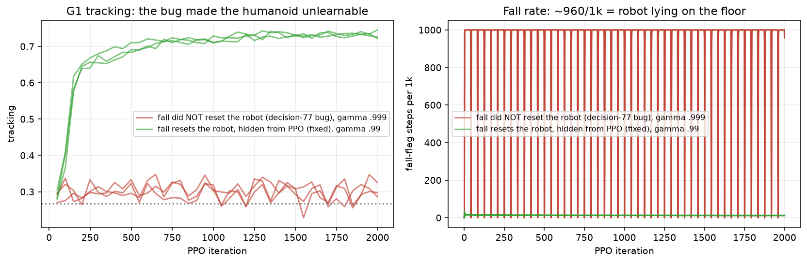
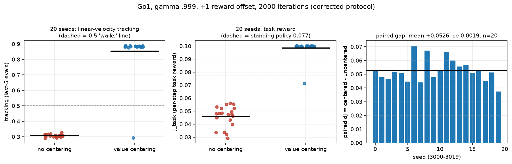
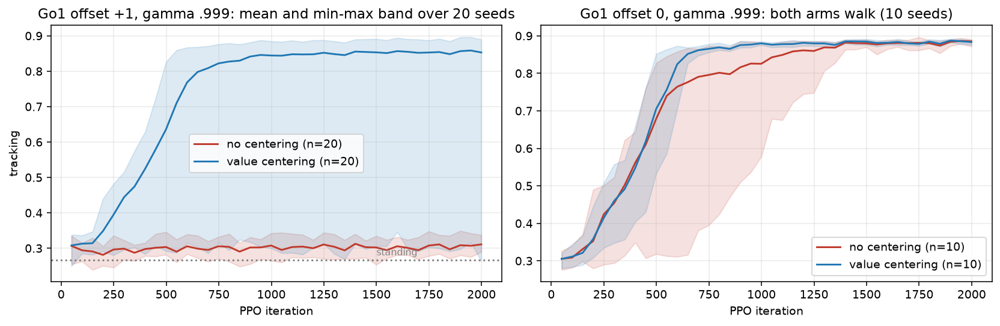
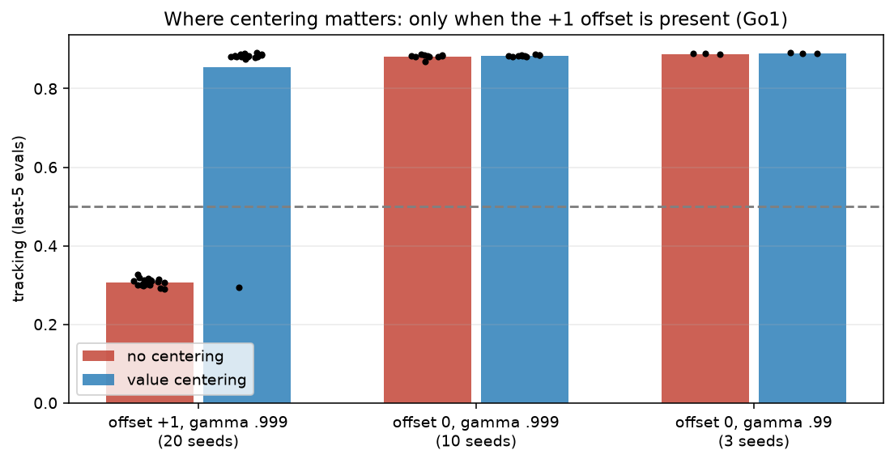
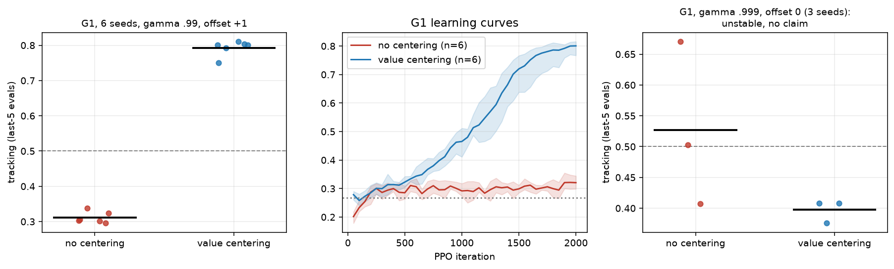
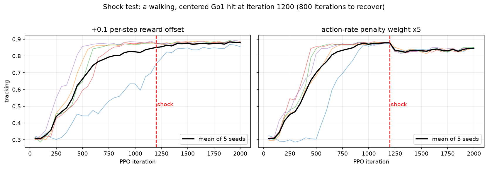

# Report 003: reward centering on continuing robot tasks, the corrected-protocol study

Written 2026-11-02. Supersedes REPORT_002 for every claim that carries a number below; REPORT_002 stays valid as the record of
the legacy 800-iteration study. Every figure here is regenerated from the R2 mirrors by
`mjlab_centering/analysis/make_report3_figs.py` (last-5-eval means, newest attempt of each run only). Decisions are cited as
`d<N>` from `docs/mjlab_centering/02-decisions.md`.

# 0. The question and the one-paragraph answer

**Question.** Does reward centering (subtracting a running estimate of the average reward) help PPO on a *continuing* GPU-parallel
robot task, and when?

**Answer.** On Go1 with a +1 constant reward offset, uncentered PPO never learns to walk (0 of 20 seeds) while centered PPO walks
on 19 of 20, a paired gain of **+0.0526 J_task (se 0.0019)**. The same effect appears on a second robot, the G1 humanoid (0 of 6
vs 6 of 6, **+0.0299, se 0.0012**). Without the offset the two arms are indistinguishable on Go1 (0.882 vs 0.884, 10 seeds), so
**the large constant offset is what makes centering necessary**. We found and fixed a protocol bug of our own along the way (a
fall removed the reset, so the humanoid lay on the floor) which had made G1 look unlearnable.

# 1. Metrics and how to read them

- `tracking` (`track_lin_frac`): linear-velocity reward normalised to 0-1. A standing robot scores about 0.27 (Go1 0.28, G1
  0.267); a walking policy scores about 0.88 (Go1) or 0.8 (G1). **0.30 means failure, not partial success.**
  "Walks" = last-5-eval mean tracking >= 0.5, fixed before launch (d73).
- `J_task`: mean per-step task reward of the deterministic policy. Go1 standing 0.077, trained 0.100; G1 standing 0.0436. Not
  comparable across robots.
- `falls per 1k`: **not comparable across protocols** - in the legacy protocol falls are hidden terminations and read about 0; in the
  corrected protocol it is a direct measurement.
- One seed = one diagnosis. Claims use 20 fresh seeds (Go1) or as many as the budget allowed (G1, 6).

# 2. The protocol, and the bug that nearly sank the humanoid result

Three protocols appear in this study; mixing them is the main way to misread it.

| name | time-outs | falls | where used |
|---|---|---|---|
| **legacy** | removed (dones always 0) | `fell_over` terminates and resets, penalty charged, hidden from PPO | waves 1-9 (800 iterations), REPORT_002 |
| **buggy v1** | kept | `fell_over` **deleted**, so the fallen robot is never reset | `pilot1-9f3a1c` only; negative control (d77, d81) |
| **corrected (default)** | kept (truncated and bootstrapped) | `fell_over` kept, so the env resets the robot in place; hidden from PPO | `fix1`, `night1`, everything in sections 4-8 |

*Figure 6.* Left: G1 tracking, red = buggy v1, green = corrected. Right: fall-flag steps per 1k, red sits at about 960 (the robot
is on the floor for most of every 20 s episode), green at about 12. Removing the fall termination also removes the reset it
triggers (verified by driving a G1 to a fall: episode counter and root height kept falling), which a lucky seed can survive but
the other seeds cannot. Two regression tests now pin the
reset and the once-per-fall penalty (d81, d82). Waves 1-9 are **not** affected (d83: the legacy path never removed `fell_over`).

# 3. Experiment inventory

| # | experiment | robot | protocol | seeds | iterations | purpose | section |
|---|---|---|---|---|---|---|---|
| E1 | continuing wrapper vs episodic gate | Go1 | legacy | 2 | 800 | does the conversion change learning | 8 |
| E2 | eta and r_bar initialisation sweep | Go1 | legacy | 3 | 800 | pick the centering step size | 8 |
| E3 | main factorial: centering x {raw, SSP} x gamma | Go1 | legacy | 10 (+3 at gamma .99) | 800 | first estimate of the effect | 8 |
| E4 | critic-fix rivals (clip off, return norm) | Go1 | legacy | 10 | 800 | is centering just "fix the critic" | 8 |
| E5 | equal-width SSP / random Fourier / raw | Go1 | legacy | 3 | 800 | representation control | 8 |
| E6 | linear-critic slice (NumPy) | Catch | n/a | exact values | n/a | mechanism | 8 |
| E7 | G1 reference probe | G1 | legacy | 1-2 | 2500-5000 | does G1 learn | 5 |
| E8 | G1 diagnosis: 4 arms | G1 | mixed | 1 | 2000 | why G1 failed | 5 |
| E9 | pilot v1 (24 jobs) | Go1, G1 | buggy v1 | 2-3 | 2000 | negative control | 5 |
| E10 | corrected pilot `fix1-b7c40a` | Go1, G1 | corrected | 2-3 | 2000 | does the effect survive the protocol change | 4 |
| E11 | **main effect, 20 fresh seeds** | Go1 | corrected | 20 | 2000 | the claim | 4 |
| E12 | offset-0 block, gamma .999 | Go1 | corrected | 10 | 2000 | is the offset necessary | 4 |
| E13 | offset-0 block, gamma .99 | Go1 | corrected | 3 | 2000 | gamma control | 4 |
| E14 | **G1 centering, gamma .99, offset 1** | G1 | corrected | 6 | 2000 | second robot | 6 |
| E15 | G1 centering, gamma .999, offset 0 | G1 | corrected | 3 | 2000 | pure high-gamma effect | 6 |
| E16 | G1 penalty check (5.7 and 10) | G1 | corrected | 1 each | 2000 | per-robot penalty rule | 6 |
| E17 | shock block | Go1 | corrected | 5 x 2 shocks | 2000 | reward-change recovery | 7 |

Total jobs this session: 33 (pilot v1, of which 10 completed) + 12 (`fix1`) + 96 (`night1`) + 4 (G1 diagnosis). Orchestrator
cost estimate about $28 (a lower bound; trust the RunPod invoice, d96).

# 4. Go1: the main effect and the role of the offset

*Figure 1.* Go1, gamma .999, +1 offset, corrected protocol, 20 fresh seeds (3000-3019), 2000 iterations. Left: tracking per seed;
middle: task reward per seed; right: paired per-seed gain.

| arm | n | tracking | J_task | walks |
|---|---|---|---|---|
| no centering | 20 | 0.307 | 0.0459 | **0/20** (max 0.328) |
| value centering | 20 | 0.854 | 0.0985 | **19/20** |

Paired gain **+0.0526 J_task, se 0.0019** (every one of 20 differences positive, range +0.0374 to +0.0708), tracking +0.547.
The one centered seed that does not walk is 3019 (tracking 0.294, J 0.0713): centering is a 95% reliable fix here, not 100%.

*Figure 2.* Mean and min-max band over seeds. Left (offset +1): uncentered stays at the standing floor for all 2000 iterations
while centered takes off at about iteration 300-600 and plateaus at 0.85. Right (offset 0): both arms take off and reach the same
level; the uncentered band lags a little in the slowest seed but the median iteration to 0.8 tracking is 549 (uncentered) vs 599
(centered), i.e. no speed advantage either.

*Figure 3.* Where centering matters.

| Go1 cell | uncentered | centered | paired dJ |
|---|---|---|---|
| offset +1, gamma .999 (20 seeds) | 0.307, 0/20 walk | 0.854, 19/20 | **+0.0526** (se 0.0019) |
| offset 0, gamma .999 (10 seeds) | 0.882, 10/10 | 0.884, 10/10 | +0.0007 (se 0.0003) |
| offset 0, gamma .99 (3 seeds) | 0.888, 3/3 | 0.890, 3/3 | +0.0001 |

**A correction worth keeping.** A 2-seed pilot read "uncentered fails at offset 0 too" (0.309 vs 0.885). At 10 seeds that was seed
noise (d94). The 2-seed table is superseded in REPORT_002; n=2 is not evidence about an interaction direction.

# 5. How G1 was diagnosed (and what remains unexplained)

All four runs: G1, gamma .99, seed 1000, 2000 iterations (d73-d75).

| arm | time-outs | falls | centering | tracking | walks |
|---|---|---|---|---|---|
| legacy wrapper, offset 0 | no | reset, hidden | none | 0.307 | no |
| legacy wrapper, offset 1 | no | reset, hidden | value | 0.309 | no |
| mjlab episodic | yes | terminal | none | 0.813 | yes |
| time-outs kept, fall terminal removed (buggy) | yes | never reset | none | 0.811 | yes |

The last row turned out to be a single lucky seed: the buggy protocol fails on seeds 1001/1002 (0.309, 0.300) and the
**episodic path itself walks on only 1 of 3 seeds** (1000: 0.813, 1003: 0.309, 1004: 0.298). So "time-outs fix G1" was an
over-read of one seed and was withdrawn (d79, d85). What is established is narrower: with the fall reset **removed**, every G1
run stayed at the floor except seed 1000 (the same seed that also walks on the episodic path), see Figure 6; with it restored the
corrected protocol walks (section 6). **Not established:** why seed 1000 walks under every protocol
while 1003/1004 do not under the episodic one, and whether the corrected protocol is genuinely less seed-fragile than the
episodic path (seed sets differ, so the 1-of-3 vs 3-of-3 comparison is unpaired).

# 6. G1: the second robot

*Figure 4.* Left: per-seed tracking, G1, gamma .99, +1 offset, penalty 5.7, 6 seeds. Middle: learning curves (mean and band).
Right: the gamma .999 offset-0 cell, 3 seeds.

| G1 cell (corrected protocol, 2000 iterations) | uncentered | centered | paired dJ |
|---|---|---|---|
| gamma .99, offset +1, penalty 5.7 (6 seeds) | 0.312, **0/6** walk | 0.793, **6/6** walk | **+0.0299** (se 0.0012) |
| gamma .999, offset 0, penalty 5.7 (3 seeds) | 0.527, 2/3 | 0.398, 0/3 | -0.0036 (se 0.0015) |

- The effect appears on a second robot with a very different morphology. Centered G1 starts improving at about iteration 600,
  crosses 0.5 tracking between iterations 999 and 1299 (median about 1100) and is **still rising at 2000**, so 0.79 is a floor on
  its converged value.
- The gamma .999 offset-0 cell is unstable at this budget (the uncentered arm is the better one, on 3 seeds). No claim is made.
- **Penalty.** Go1's frozen fall penalty of 10 is about 130x its standing per-step reward and about 230x G1's. The pre-registered
  rule P = 130 x standing reward gives 5.7 for G1 (d82). Checked on seed 1000, offset 0, no centering: penalty 5.7 reaches 0.787,
  penalty 10 reaches 0.550. One seed each, so the safe statement is "penalty 10 costs G1 a lot of tracking reward at this budget",
  not "breaks it" (an earlier version of this claim came from a run killed at iteration 900 and was corrected, d90/d97).

# 7. Shock test (limited)

*Figure 5.* A walking, **centered** Go1 (offset +1, gamma .999), hit at iteration 1200 with 800 iterations left, 5 seeds each.

| shock | pre-shock (iter 1149) | lowest after | end (iter 1999) | reading |
|---|---|---|---|---|
| +0.1 per-step reward offset | 0.88-0.89 on 4 of 5 seeds (seed 3000 was still climbing at 0.70) | 0.86-0.87 | 0.88-0.89 | absorbed, dip <= 0.02 |
| action-rate penalty weight x5 | 0.87-0.88 | 0.81-0.82 | 0.84-0.85 | dip 0.05-0.07, recovers only 38-54% in 800 its |

**What this does and does not show.** A reward-weight change costs a centered agent about 6 points of tracking and it is still
climbing back when the window ends; a small constant offset is absorbed by the running average reward, as the method intends. It
does **not** test the practitioner question "does centering make shocks safer", because the shocked runs are all centered: there is
no uncentered arm (uncentered Go1 never walks at offset +1, so there is nothing to shock). The designed test - train without the
offset so both arms walk, then shock, centered vs uncentered - was **not run** (d99).

# 8. What the legacy (800-iteration, no-time-out) study contributes

Measured under the legacy protocol and **not re-run** under the corrected one, so treat these as supporting evidence only:

| result | numbers | status |
|---|---|---|
| gate: wrapped vs episodic Go1 | tracking 0.89 vs 0.89, J 0.103 vs 0.103 (2 seeds) | accepted on substance; did **not** generalise to G1 |
| main effect, gamma .999, 10 seeds | J 0.0296 -> 0.0850 (+0.0554, 95% CI [+0.0507, +0.0603]), tracking 0.31 -> 0.71 | superseded in size and length by section 4 |
| gamma .99, 3 raw seeds | +0.0375 [+0.0338, +0.0395] | the only Go1 evidence at gamma .99 with the offset |
| critic-fix rivals (10 seeds) | clip-off J 0.0679 / tracking 0.308; return-norm 0.0236 / 0.299; centering 0.0850 / 0.710 | clip-off recovers most reward but none of the behaviour |
| eta | 0.01 fails; 0.03 with zero init collapses 1 of 3; 0.1 / 0.3 work; 0.03 with first-batch r_bar 3 of 3 | eta and init confounded |
| equal-width encoders (3 seeds) | raw 0.097 / 0.83, HexSSP 0.082 / 0.54, random Fourier 0.072 / 0.44 | SSP beats a random code of the same width, not raw |
| SSP x centering interaction | -0.0220 [-0.0276, -0.0169] | **provisional**: centered arms had not converged at 800 iterations |
| linear-critic slice (Catch, exact values) | uncentered raw: state-dependent error 147 vs 0.03 centered | mechanism evidence; SSP was not special there |

# 9. Conclusions

**Supported**

1. With a large constant reward offset (+1, about 10x the per-step task reward), centering turns a failing PPO into a working one:
   Go1 0/20 -> 19/20 walks (paired +0.0526, se 0.0019), G1 0/6 -> 6/6 (+0.0299, se 0.0012). Two robots, two morphologies, 26 seeds.
2. Without the offset, centering does nothing measurable on Go1 (10 seeds, +0.0007; gamma .99 also a tie). The offset, not the
   discount factor, is what the effect depends on in our data.
3. The effect is robust to the protocol revision: it appears on Go1 under the legacy protocol (800 iterations) and on Go1 and G1
   under the corrected protocol (2000 iterations). (G1 was not measurable under the legacy protocol.)
4. A reward-weight change (action-rate x5) costs a walking centered Go1 about 6 points of tracking and is only partly recovered in
   800 iterations; a +0.1 offset is absorbed.
5. Methodology: a plausible one-line protocol change (dropping a termination) silently removed a reset and made a robot
   unlearnable; the signature was a fall rate of 960 per 1k. It is now guarded by tests.

**Not supported / not tested**

- That centering requires a high discount factor (never isolated; no gamma sweep at fixed offset).
- Any dependence on offset size: only c = 1 and 0 were run. Whether realistic offsets (for example a 0.1 alive bonus) matter is
  unknown, which is the practicality question the study was asked.
- That centering makes reward-change shocks safer (the proper centered-vs-uncentered shock test was not run).
- That centering beats cheaper critic fixes under the corrected protocol (the rivals were run only in the legacy study).
- Any SSP claim under the corrected protocol: the SSP x centering interaction is provisional, the width stage was never run, and
  SSP never beat raw input.
- That G1 is reliably learnable: 3 of 3 corrected-protocol seeds at offset 0 and 6 of 6 centered at offset 1, but the episodic path
  walked on 1 of 3, the seed sets are unpaired, and the centered G1 curve has not plateaued.
- G1 at gamma .999 (unstable at 2000 iterations).
- One centering variant (value) and one eta (0.03 with first-batch r_bar) only.

# 10. Limits worth stating in any write-up

Two robots, one task (velocity tracking), 2000-iteration runs, PPO only. Seed counts range from 20 (Go1 main effect) to 3 (several
controls). Centered Go1 reliability is 19/20. The 2-seed pilot misled us once (section 4), so any further 2-3 seed cell should be
labelled a pilot. The corrected protocol differs from the legacy one, so numbers from sections 4-7 and section 8 must never be
pooled in one table.

# 11. Suggested next experiments (cost order)

1. **The proper shock test** (about $3): policies trained at offset 0 (both arms walk), then shocked with +0.1 or +1 offset or the
   action-rate x5, centered vs uncentered, 10 seeds, 400+ iteration recovery window.
2. **Offset sweep at fixed gamma** (about $4): c in {0.1, 0.3, 1} for Go1, to answer how large an offset has to be before it hurts.
3. **Re-run the critic-fix rivals under the corrected protocol** (about $4, 10 seeds) so "centering vs cheaper fixes" is not a
   legacy-only claim.
4. A **gamma sweep at offset +1** (about $3) to settle whether gamma matters.
5. G1 longer budget at gamma .999 (about $3), and the SSP width stage (about $3).
