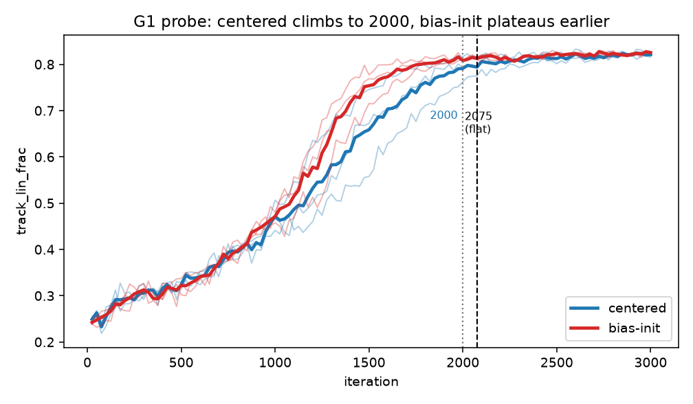
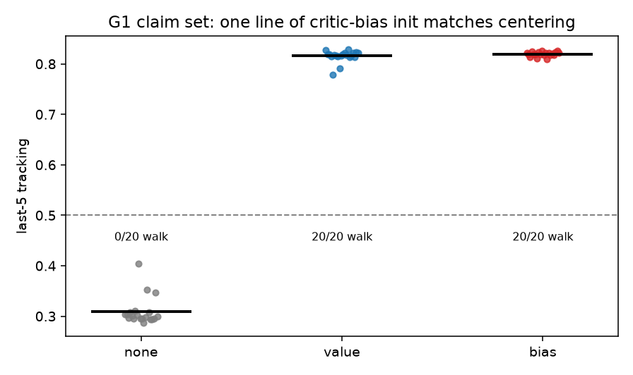
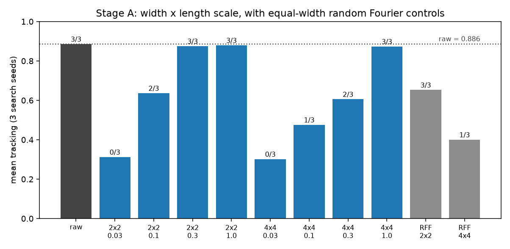
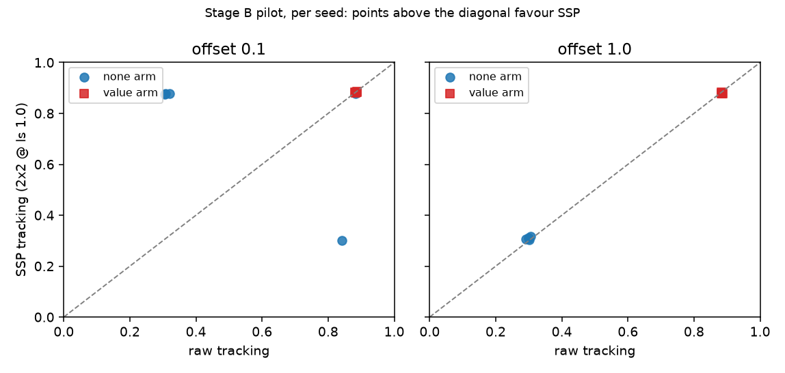
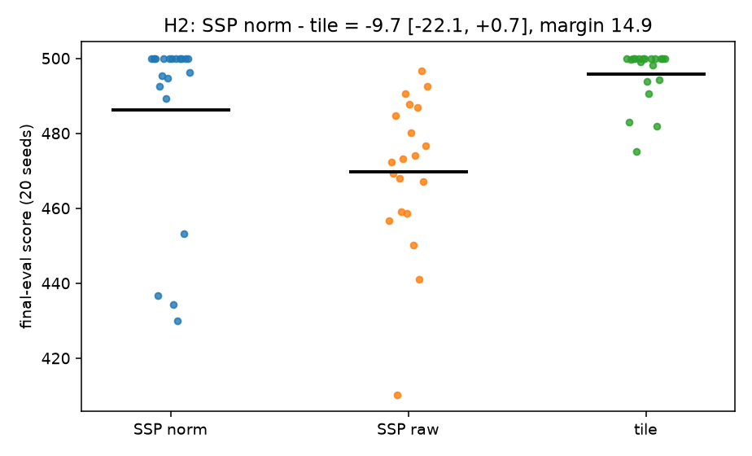

# Report 006: G1 convergence and claim set, SSP width and pilot, CartPole length scale (H2)

Draft, written 2026-11-04 and updated through 2026-11-06 while the round ran. Placeholders are marked TBD and are filled
from the run files, never from memory. Decisions are `d<N>` in `docs/mjlab_centering/02-decisions.md`; the round-6 rules are d126-d133 and
were frozen (hashed, uploaded to R2 under `_prereg/round6/`) before the first launch.

## 0. What was run, and the standing rules

| step | design | seeds | status |
|---|---|---|---|
| 1 G1 probe | G1, gamma .99, offset +1, penalty 5.7, 3000 its, evals every 25, {value, bias-init} | search 1000-1002 | **done**: flat at 2075 -> length 2500 |
| 2 G1 claim set | same cells x {none, value, bias-init}, length from the probe rule | claim 3000-3019 | **done**: 60/60, $8.41 |
| 3a SSP width | centered, offset +1, gamma .999, raw / ssp 2x2, 4x4 / matched RFF | search 1000-1002 | **done**: 2x2 matches raw, beats RFF |
| 3a' length-scale sweep | best width at ls {0.03, 0.1, 0.3, 1.0}, unconditional (d138) | search 1000-1002 | runs after 3a |
| 3b SSP x centering | best SSP x {none, value} x offset {0.1, 1}, **pilot** | 3000-3004 | **done**: escalation fired, not run (budget) |
| 4 H2 CartPole | ssp_h2 / ssp_h2raw / tile_h2, linear DQN, length scale 0.01-1 | search 0-99, filter 1000+, claim 3000-3019 | **done**: $1.0 |

Caps (d126): **$20 GPU** (community only) and **$3 H2 CPU** (secure cloud, the approved one-off exception, reported
separately). Cut order, last cut first: G1 claim set > SSP Stage A > H2 > SSP Stage B > Stage-B escalations.
Seed rule: fewer than 20 paired seeds is a pilot; claims use 3000-3019; search seeds are never pooled with claim seeds.

**H2 seed note (for the reader).** H2's claim seeds 3000-3019 are the seed block the old CartPole study used as its
*replicate* block for the old configurations (tile/none/linear 499.64 +- 0.99, ssp/none/linear 461.65 +- 35.88, etc.).
They were **not** used to tune any H2 configuration: the search ran on trial seeds 0-99 and the re-filter on 1000-1004,
so the claim block is untouched by tuning. Reusing them is deliberate — it lets the new arms be read beside the old
numbers on identical seeds — and it is not a tuning reuse.

## 1. G1: the probe, the run length, and the claim set (d127, d128)

*Figure 1.* G1 probe, three seeds per arm, thin lines per seed and thick line the mean. Both arms walk by ~2000; the
centered arm is still rising there while bias-init has flattened. The dashed line is the iteration at which the
pre-registered rule says both arms are flat (2075), which sets the claim length to 2500.

**Probe** (6 jobs, 3000 iterations, evals every 25, search seeds 1000-1002). At iteration 2000 the centered arm was still
rising on all three seeds (slopes +0.0297, +0.0100, +0.0178 per 100 iterations; tracking 0.751, 0.814, 0.795) while the
bias-initialised arm was flat on all three (+0.0093, +0.0026, +0.0034; 0.805, 0.814, 0.809). The first iteration at which
both arms pass the rule is **2075**, so the claim length is **2500** (2075 + 250 buffer, rounded up). Both arms walk by
2000 at about 0.80 tracking: this was a plateau decision, not evidence that learning converges to an optimum at 2500.

**Claim set** (fresh seeds 3000-3019, 2500 iterations, 60 jobs, corrected protocol):

| arm | n | tracking | J_task | walks | t50 | t90rel |
|---|---|---|---|---|---|---|
| no centering | 20 | 0.309 | 0.0610 | **0/20** | never | n/a |
| value centering | 20 | 0.816 | 0.0941 | **20/20** | 1065 | 1477 |
| bias-init | 20 | 0.820 | 0.0949 | **20/20** | 1041 | 1463 |

*Figure 2.* G1 claim set, per-seed last-5 tracking at 2500 iterations, 20 seeds per arm. Uncentered never leaves the
standing floor; centering and the one-line critic-bias initialisation are indistinguishable.

Paired, all 20 seeds: value - none **dtrack +0.5063 [+0.4903, +0.5179]**, dJ **+0.0331 [+0.0318, +0.0344]**, +20 walks;
bias - none **dtrack +0.5102 [+0.4969, +0.5201]**, dJ **+0.0339 [+0.0328, +0.0350]**, +20 walks. Against a floor of 0.309,
every paired difference is positive and none of the 20 uncentered seeds leaves the standing floor.

**Bias-init and centering are the same intervention at this offset.** bias - value: dtrack **+0.0040 [-0.0005, +0.0096]**,
dJ **+0.0007 [-0.0001, +0.0018]**, walk counts identical — inside the d117 equivalence margins on all three.

**Speed: the probe's impression does not survive 20 seeds.** The probe suggested bias-init gets to the plateau sooner
(flat at 2000 against the centered arm's +0.010 to +0.030). At 20 seeds: t50 median delta **+0.1 iterations**
(10 of 20 seeds faster, 95% CI [-109, +32]); t90rel median delta **-50.8** (12 of 20, CI [-152, +40]). Absolute t90 does
not exist on G1 - no seed of any arm exceeds about 0.83 tracking - so t90rel is the iteration reaching 90% of that
seed's own final level, counted only for seeds that walk. **The honest statement is: same destination, same speed.** The
10-seed pilot read bias as faster by 49-119 iterations; at 20 seeds that is gone, which is exactly why the seed rule
exists. Reported because it was promised, and because it is a clean example of a 10-seed difference that does not replicate.

Cost of this step: probe about $0.2; claim set 150,000 iterations for **$8.41** measured (a $0.22/h 3090 and a $0.33/h
A6000, 60 jobs, about 12 h of wall time including a long starving period in the middle).

## 2. SSP width stage, length-scale sweep, Stage B (d129, d130, d138)

The length-scale rule was amended before the stage ran (d138, user's instruction): the conditional 0.15/0.6 check was
replaced by an **unconditional** log-spaced sweep at the winning width, {0.03, 0.1, 0.3, 1.0}, three search seeds: 9
new jobs per width, because 0.3 is the width-stage cell. The sweep is carried for **both** 2x2 and 4x4 (18 jobs in the
queue) because a pod runs the
manifest it downloaded and cannot be retargeted once the width result is known; the reading rule takes the winning
width first and only then its length scale (d149). The reason for sweeping at all is this round's own CartPole result: the optimum there sits at 0.015-0.022,
more than 10x below the default of 0.3, so a fixed 0.3 on Go1 could produce the same artifact. Selection is the highest
mean tracking, ties to the length scale nearest 0.3 in log space, decided before the runs. Stage B then uses the best
(width, length scale). The purpose is a defensible null, not an SSP win.

**Run status: complete.** All 30 width/sweep jobs finished on 2026-11-07, and the 20-job Stage-B pilot on 2026-11-08;
both pods deleted themselves and the close-out script removed the rest (marker `results/r6_AUTOCLOSED`, 07:36 UTC). The
stage ran on a 3090 at $0.22/h after nine captures (six lost to host faults, one to a six-hour DNS outage). It runs after a real bug was found and fixed: every encoder
job had been dying at env construction because `sspspace` (needed for the HexSSP phase matrix, and even for the RFF arm's
reference width) was never a dependency of `mjlab_centering` - it existed locally, not in the pod venv. Diagnosed by
pushing four five-iteration bisection jobs onto a warm pod (raw 4 envs OK, raw 2048 OK, ssp_low 4 envs failed, ssp_low
2048 failed), fixed by adding the pinned dependency, an encoder self-test in the bootstrap, and a failure-log upload
(d1012); a stale-claim bug then blocked the rerun and was fixed by releasing claims on success and failure (d1013).
Earlier status, kept for the record: at 21:50 UTC the stage was running, after the seventh capture (RTX 5090-class, $0.69/h) booted
cleanly at 21:41 UTC with torch 2.14.1+cu130 and passed its CUDA smoke test, after six captures were lost to host-side
driver/device faults (d1001-d1011). Earlier status, kept for the record: the stage had not run. It was queued at 2026-11-05 15:24 UTC and has since had
2,140+ refused `create` calls and two captures that produced no work: the first (02:06 UTC, $0.69/h) could not load torch's
cu130 build after 45 min of installs, the second (09:09 UTC, $0.33/h, A6000) advertised CUDA >= 13 and then failed the
cu130 check one minute in. Three independent one-shot probes at 08:14 UTC (5090, L40S, 3090, minimal specs, no datacentre
pin) were all refused, so the scarcity is platform-wide on this account rather than a property of our request. Three
mitigations are now in place and take effect on the next capture: a driver preflight (one minute), an early torch-only
smoke test before the rest of the stack (five minutes, ~$0.05), and a **cu128 retry on the same host** when the cu130
wheel cannot see the device (d1001-d1004). CUDA-12.6+ hosts are usable via torch 2.11 (d1003), and any campaign that may use
that channel runs with a single pod so one torch build covers every cell.

*Figure 4.* Stage A: mean tracking per cell over three search seeds, bar labels give the walk count. Grey bars are raw
input and the equal-width random Fourier controls; blue bars are SSP. The dotted line is raw input.

**Width stage (the 12 jobs; three search seeds, centered, offset +1, gamma .999, 2000 iterations).**

| cell | seeds | mean tracking | walks |
|---|---|---|---|
| raw | 3/3 | 0.886 | 3/3 |
| ssp 2x2 @ ls 0.3 | 3/3 | **0.875** | **3/3** |
| ssp 4x4 @ ls 0.3 | 3/3 | 0.606 | 2/3 |
| ssp 4x4 @ ls 0.03 | 3/3 | 0.302 | 0/3 |
| ssp 4x4 @ ls 0.1 | 3/3 | 0.476 | 1/3 |
| ssp 4x4 @ ls 1.0 | 3/3 | **0.874** | **3/3** |
| matched RFF 2x2 | 3/3 | 0.653 | 3/3 |
| matched RFF 4x4 | 3/3 | 0.400 | 1/3 |

**The width ordering depends on the length scale, and the sweep shows why.** At ls 0.3, 2x2 (0.875) beats 4x4 (0.606); at
ls 1.0 the two nearly tie (0.880 vs 0.874). So the "4x4 is worse" reading at the default length scale was mostly a
mismatched length scale for the wider code, not a width effect - the same failure mode H2 found on CartPole, one level up.
Both widths at ls 1.0 land within 1 point of raw (0.886).

By the rules fixed in d105: the best width is **2x2** (judged at ls 0.3, as pre-registered); it closes the gap to raw (+0.011, inside the 0.03 margin);
it beats the equal-width random code by 0.222 and walks at least as often; the 8x8 pilot is **not** triggered (4x4 did
not beat 2x2). So the two things this stage exists to separate are separated: at this width the *structured* code carries
the advantage over a random code of the same width, and the remaining gap to raw input is 1.1 tracking points on three
seeds.

Still running at the time of writing: the 18 length-scale jobs (the sweep at both widths). The gate uses the winning
width 2x2 and the best of {0.03, 0.1, 0.3, 1.0} within it; at the time of writing 0.3 is measured at 0.875 and the other
three are in flight.

**Sweep at the winning width (2x2), three seeds each, all finished:** ls 0.03 -> **0.312** (0/3 walk, at the standing
floor), 0.1 -> 0.636 (2/3), 0.3 -> 0.875 (3/3), **1.0 -> 0.880 (3/3)**. The gate therefore runs Stage B on `ssp2x2@1.0`, which walks on 3/3 search seeds. Note the
contrast with H2: on CartPole the optimum was ~0.02, on Go1 it is 1.0. The length scale is task-specific; a fixed 0.3 was
neither right nor disastrous here.

**Stage B pilot** (launched 06:16 UTC, `r6sspp-e8af4cb0`): best SSP (2x2, ls 1.0) x {none, value} x offset {0.1, 1.0} x
seeds 3000-3004, 20 jobs, labelled pilot. **Caveat to carry into its table:** the SSP cells run on torch 2.14.1+cu130,
while the raw cells they are paired with are round-4/5 runs made before the build was recorded in `config.json` (d122).
Four of those raw cells (offset 0.1, seeds 3003-3004, both arms) were re-run on cu130 in round 6 and are kept separately
(`results/merged_r2_rawtop`) as a **cross-build replication check**; they are never mixed into the pairing, which uses the
original cells on all five seeds. The first such comparison is reassuring: offset 0.1, uncentered, seed 3003 gives 0.320
on the round-4 build and 0.305 on cu130 - both at the standing floor.

**Reading rules for the pilot table below (fixed in d130, before launch).** Per offset, with Delta = SSP - raw on the
same seed: escalate a *cell* if the walk counts differ by 2 or more of 5; escalate *both arms at an offset* if the mean
difference-in-differences of tracking exceeds 0.10 in magnitude; otherwise report a pilot null. Everything here is a
5-seed pilot and none of it is a claim; the pre-registered escalation is what turns a cell into a 20-seed cell.

*Figure 5.* Stage B pilot, per seed: SSP against the raw cell on the same seed. Points above the diagonal favour SSP; the
offset-0.1 panel is the seed-flipping pattern discussed below, and the offset-1.0 panel is the null (both arms at the
floor uncentered, both at ~0.88 centered).

**Pilot results, all 20 jobs, five paired seeds** (`ssp_low 2x2 @ ls 1.0`):

| offset | arm | SSP tracking | raw tracking | dtrack | walks SSP | walks raw |
|---|---|---|---|---|---|---|
| 0.1 | none | **0.762** | 0.532 | **+0.230** | **4/5** | **2/5** |
| 0.1 | value | 0.883 | 0.885 | -0.002 | 5/5 | 5/5 |
| 1.0 | none | 0.309 | 0.299 | +0.010 | 0/5 | 0/5 |
| 1.0 | value | 0.879 | 0.885 | -0.006 | 5/5 | 5/5 |

Difference-in-differences of tracking: **offset 0.1 -0.232 (se 0.222)**, offset 1.0 -0.016 (se 0.004).

**Both pre-registered escalation rules fire at offset 0.1** - the uncentered cell's walk counts differ by 2 of 5, and the
mean interaction exceeds 0.10 - but **the escalation is not run**: the round stands at about $19 of the $20 cap and d126's
cut order names Stage-B escalations as the first thing cut. That is the pre-registered outcome, reported as it stands.

**Reading, honestly.** The offset-0.1 effect is *seed-flipping, not a shift*: per-seed differences run from +0.536 to
-0.572, and with sd 0.495 the standard error of the mean is 0.222, so the interval contains zero comfortably. What can be
said is narrower and still useful: on the three seeds where raw collapses to the standing floor under a 0.1 offset
(0.305-0.320 tracking), SSP walks (0.876-0.879); on the one seed where raw walks (0.841), SSP is at the floor (0.301). So
SSP is not uniformly better - it fails where raw succeeds on one of five - and five seeds cannot separate that pattern from
luck. At offset 1.0 there is no interaction at all (-0.016): both uncentered arms sit at the floor and both centered arms
walk, which is what the offset-size result predicts at the large offset. **No claim of an SSP x centering interaction is
made; the round's honest summary is "a 0.1-offset reliability difference that the pre-registered rule escalates and the
budget stops."** The cross-build raw rerun (d1017) reproduces raw's floor on seed 3003 (0.305 vs 0.320), so the raw side of
the pattern is not a build artifact.

## 3. H2, the CartPole length-scale test (d131, d132)

Design in one paragraph: RUN_005 found that one isotropic length scale cannot resolve theta (range 0.418) and omega
(range 20) at once, and that resolving theta at the failure cliff needs 0.042 in raw units — 2.4x below the old search
floor of 0.1. H2 asks whether SSP's 38-point deficit to tile coding on CartPole was therefore a tuning artifact.
Three arms, identical pipeline and trial budget, no warm start: `ssp_h2` (per-dimension input normalisation, length
scale searched over [0.01, 1]), `ssp_h2raw` (the same search without normalisation, so the wider range and the
normalisation are separable), `tile_h2` (tile coding, same budget). 100 Optuna trials per arm, re-filter pool 8 x 5
seeds, final evaluation on 20 fresh seeds 3000-3019 (the old study's replicate block; never used for tuning, section 0).

*Figure 3.* H2 per-seed final-eval scores. The SSP arms are wider and sit lower; tile coding is at the ceiling, which is
why the pre-registered margin is on the paired difference and not on the means.

| arm | n | final-eval mean | std | min | max | solved | chosen length scale |
|---|---|---|---|---|---|---|---|
| ssp_h2 (normalised) | 20 | **486.1** | 24.3 | 429.9 | 500 | 80% | 0.0220 |
| ssp_h2raw | 20 | 469.8 | 19.8 | 410.3 | 496.6 | 40% | 0.0152 |
| tile_h2 | 20 | **495.8** | 7.2 | 475.1 | 500 | 100% | — |

Paired, by seed (bootstrap 95%, 5000 resamples): ssp_h2 - tile_h2 = **-9.66 [-22.07, +0.68]**, 5 of 20 seeds positive;
the pre-registered margin is 14.87 (3% of the tile mean). ssp_h2raw - ssp_h2 = -16.35 [-31.19, +0.52].

**Reading, by the rules fixed before launch.** R1 ("the CartPole loss was tuning") needs the lower bound above
-margin; it is -22.07. R2 ("inherent at this width") needs the upper bound below -margin; it is +0.68. The interval
spans the margin, so the pre-registered verdict is **inconclusive** — the honest summary is that the deficit fell from
about 38 points (old ssp/none/linear 461.65 vs tile 499.64) to **9.7 points, with an interval that cannot exclude
either a tie or a 22-point deficit**. R3: the unnormalised wide-range arm is 16.3 points below the normalised one on
average, but its interval also spans the margin, and both arms recovered most of the old gap — so **the length-scale
range, not the normalisation, is what was binding**.

Supporting evidence that this was a search-space problem rather than a seed problem: **both arms' winning length
scales sit 4-7x below the old floor of 0.1** (0.0220 normalised, 0.0152 raw). The old search could not express either
value, which is RUN_005's claim, now confirmed by a search that was allowed to look there. The single-seed anecdote from
the timing run (unnormalised SSP at ls 0.3 reaching 500) is not used: the 20-seed arms settle it.

**Where the search put the length scale (re-filter candidates, mean of 5 seeds).** This is the sharpest part of the
result, because it shows the old range could not have contained the answer:

| arm | rank | length scale | re-filter mean |
|---|---|---|---|
| ssp_h2 | 1 | 0.0220 | 493.0 |
| ssp_h2 | 2 | 0.0234 | 490.9 |
| ssp_h2 | 3 | 0.0161 | 490.9 |
| ssp_h2 | 4-8 | 0.0119-0.0344 | 459.7-473.5 |
| ssp_h2raw | 1 | 0.0152 | 482.4 |
| ssp_h2raw | 2-8 | 0.234-0.500 | 358.6-440.5 |
| tile_h2 | 1 | n/a | 499.5 |

Every one of ssp_h2's eight candidates sits below 0.035, and the unnormalised arm only works at its single smallest
draw (0.0152); its next seven candidates, all in 0.23-0.50, are 42-124 points worse. The old search space was
[0.1, 1]: **it excluded every top-8 candidate of both SSP arms.** That is RUN_005's mechanism, demonstrated rather
than asserted.

Cost: three `cpu3c` pods at $0.06/h, about 5.5 h of wall time, **about $1.0 for the CPU run** (the guard's rate x uptime
ledger read 0.31 for the last surviving pod's share of an earlier leg; the billing total since `h2_start`, which also
contains GPU probe spend, was $1.31). Well inside the $3 cap. Note for the record: the billing API labels CPU pods with
the account's GPU name, so CPU spend cannot be separated by the `gpuId` field; the guard integrates each H2 pod's own
rate x uptime instead (d134).

## 4. Cost, measured rather than estimated

From the billing API (marks `start_round6` for GPU, `h2_start` for CPU), reconciled with the rate x wall time of each
pod, because the billing buckets are one hour wide and the API labels CPU pods with the GPU name.

| step | what it cost | basis |
|---|---|---|
| G1 probe (6 jobs x 3000 its) | about $0.10-0.20 | one $0.69/h pod, 1.8 h |
| G1 claim set (60 jobs x 2500 its) | **$8.41 measured** | two pods ($0.22/h 3090, $0.33/h A6000), about 12 h wall including a starving period |
| H2 (3 arms, 100 trials + re-filter + final) | about **$1.0** | three $0.06/h `cpu3c` pods, about 5.5 h |
| SSP width stage + length-scale sweep (30 jobs, 60k its) | **$5.51** | 3090 at $0.22/h plus $0.66 of failed captures | queued since 2026-11-05 15:24 UTC; 2,140+ refused creates; two captures lost to driver/torch mismatches (d1001-d1004); projected ~$2.0 at $0.033/1000 its |
| Stage-B pilot (20 jobs) | **$3.02** | 5090-class at $0.69/h then 3090 at $0.22/h after a preemption |
| Raw top-up (4 jobs, build check) | ~$0.6 | spent on a mistaken "missing seeds" diagnosis (d1017) |
| **round-6 total** | **about $19** | against the $20 cap; the escalation would have exceeded it |

Not a cost line but the round's main operational fact: community capacity refused every create for about three hours
(six one-shot probes across SKUs, datacentres and with no pin at all, against a listing that showed stock), so the
claim set is running on the single pod already held and costs wall time rather than money (d142).

## 4b. Reproducing this report

`python mjlab_centering/analysis/report6_checks.py` re-derives every number quoted above from R2 - the probe's 2075/2500
verdict, the three claim arms with their paired contrasts and the d117 equivalence, and the H2 means with the paired
interval - and exits non-zero if any of them has moved. It passed at the time of writing. The figures come from
`analysis/make_report6_figs.py`, the tables from `analysis/ssp_report_table.py`, and the claim numbers from
`analysis/g1_claim_report.py`; none of the numbers in this report were typed by hand.

## 5. What changed in the claims

**CartPole (H2) — a correction to the record, not a win.** REPORT_001 said SSP loses to tile coding on CartPole
(461.65 vs 499.64 at 20 seeds) and RUN_005 attributed it to a single isotropic length scale that could not resolve
theta and omega at once. H2 shows what that meant in practice: with the range widened and the inputs normalised, SSP
reaches **486.1** and the paired deficit falls to **-9.7 [-22.1, +0.7]**, inside the 3% margin on the point estimate but
not resolvable at 20 seeds. The decisive detail is not the mean but the search: **every** top-8 candidate in both SSP
arms chose a length scale below 0.035, and the unnormalised arm's runner-up length scales (0.23-0.50) are 42-124 points
worse. The old search space [0.1, 1] excluded all sixteen. So the correct statement is: *the CartPole comparison
under-reported SSP because the search could not express the length scale the data wants; with a fair range SSP is
within about 10 points of tile coding and 80% vs 100% solved, which is a tie inside the noise on a task where tile
coding is close to ideal.* It is not evidence that SSP matches tile coding, and it does not transfer to Go1.

**G1 run length.** The probe turned a guess into a measurement: the centered arm was still climbing at 2000
(+0.010 to +0.030 per 100 iterations on all three seeds) while the bias-initialised arm was already flat, so the claim
set runs at **2500**, not 2000. Any G1 claim at 2000 would have measured the centered arm mid-climb.

**G1 claim set — both fixes work on the humanoid, and they are the same fix.** Uncentered 0/20 walks (0.309 tracking),
value centering 20/20 (0.816), bias-init 20/20 (0.820); paired dtrack +0.506 [+0.490, +0.518] and +0.510
[+0.497, +0.520] against the floor, and bias - value inside the equivalence margins on tracking, J_task and walk counts.
This is the Go1 mechanism reproduced on a second morphology at a measured run length (2500), with 20 fresh seeds.

**A promised measurement that did not replicate.** The probe suggested the bias-initialised critic plateaus earlier than
the centered one (flat at 2000 vs still climbing), which would have made "same result, faster when the offset is known"
a useful practitioner line. At 20 seeds there is no difference in arrival time (t50 median delta +0.1 iterations; t90rel
-50.8 [-152, +40]). The 10-seed version of that comparison was -49 and -119 iterations. Reported because it was promised,
and because it is a clean example of a small 10-seed difference that disappears under the seed rule.

**SSP, in one paragraph.** With the length scale swept rather than fixed, SSP at 2x2 lands within 0.6 tracking points of
raw input (0.880 vs 0.886) and beats an equal-width random code by 0.22; the apparent disadvantage of the 4x4 code at the
default length scale disappears once 4x4 is allowed its own (0.874 at ls 1.0). The pilot then finds no interaction with
centering at offset 1.0 (-0.016) and one at offset 0.1 (a 2-of-5 walk difference, mean -0.232, se 0.222) which the
pre-registered rule escalates and the budget stops. So the round supports "SSP is a usable encoder at parity with raw when
its length scale is searched", not "SSP interacts with centering".
