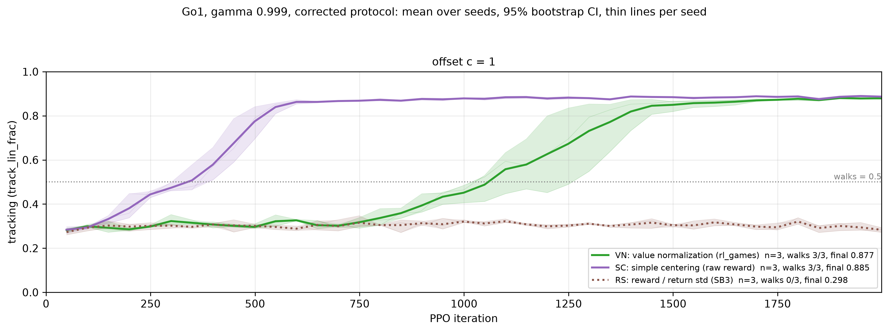
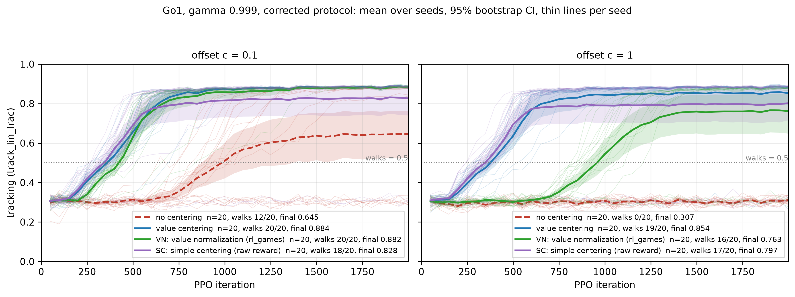

# Report 007: two rival fixes for the reward offset on Go1 — value normalization, and simple centering

Written 2026-11-07 from the run files. Opened as a draft on 2026-11-06 before the first launch. The pre-registered rules (d155-d159 in
`docs/mjlab_centering/02-decisions.md`) were hashed and uploaded to R2 under `_prereg/round7/`
(`round7_prereg.sha256.json`, written 2026-11-06T08:38:53Z) before any pod was requested. Every number comes from the run files and the readout scripts, never from memory: `analysis/r7_report.py` (tables, the mechanical
reading, the figure) and `analysis/r7_spend.py` (cost, attributed per pod).

**Abstract.** Two alternatives to value-based reward centering are tested on Go1 velocity tracking at gamma .999 under the
corrected protocol, 20 paired seeds per cell: rl_games-style **value normalization** (VN) and **simple centering** of the raw
reward (SC), plus SB3-style **return-std scaling** (RS) as a control. **VN is equivalent to value centering at the
practitioner offset c = 0.1** (20/20 seeds walk, tracking 0.882 vs 0.884, `J_task` and walking counts inside the
pre-registered margins) but **loses four seeds at c = 1** (16/20 against 19/20, tracking 0.763 against 0.854), so it does
most of centering's job and not all of it. **SC is partial at both offsets**: at c = 0.1 it beats uncentered
(+0.183 tracking, CI [+0.031, +0.335]) but walks 18/20 against value centering's 20/20 and is not equivalent to it; at c = 1
it walks 17/20 with tracking 0.797. **RS does nothing** — scaling by the return std divides the offset instead of removing
it (0/3 pilot seeds walk). Cost $18.58 settled against an $18 cap (58 cents over; the live reading at 80/80 was $18.03 and the closing minutes settled later); Stage 3 was cut by the pre-registered gate; it later got its own $4 round, which completed ten of forty runs before the money ran out and is reported in section 12 as a pilot, not a claim.

## 0. What was run, and the standing rules

The question: two obvious alternatives to value-based centering have not been tested on the robots. Does **standard
value normalization** already fix the offset failure, and does the **simplest form of centering** — a running average of
the raw reward — do as well on-policy?

| stage | design | seeds | runs | status |
|---|---|---|---|---|
| 1 pilots | VN, VN without the +-5 clamp (diagnostic), RS, SC at c = 1, 2000 iterations | search 1000-1002 | 12 | **done** ($1.40 of compute) |
| 2 claims | VN and SC, c in {0.1, 1} | 3000-3019 | 80 | **done**: 80/80, 20 paired seeds per cell (claim grade) |
| 3 claims | RS, same seeds and offsets | 3000-3019 | 40 | only if the budget gate allows it after stage 2 |

Protocol throughout: the corrected one (time-outs kept and bootstrapped, falls reset in place and hidden from PPO),
Go1, gamma 0.999, fall penalty 10, 2000 iterations, mjlab defaults, 2048 envs, evals every 50 (the paired cells'
cadence). Every new run logs the per-step reward std (`task_rew_std`, `raw_rew_std`).

**Spending rules (d155).** Community GPUs only, **$18 hard cap**, no secure cloud without asking. A stage launches only
if `spent + 1.3 x projected <= 18`. The billing API is read after every stage, attributed to **this brief's own pods**
(`analysis/r7_spend.py`, per-`podId`), because the SSP width campaign runs concurrently on the same account and the
account-level delta would mix the two. Seed rule unchanged: fewer than 20 paired seeds is a pilot; search seeds are never
pooled with claim seeds.

**Isolation.** One orchestrator and one campaign per stage (`mjc-r7pilot-*`, `mjc-r7vnsc-*`, `mjc-r7rs-*`); the running
SSP campaign and the video jobs are not touched. The code changes only add new option values, and the pre-existing test
suite passes with them.

## 1. The arms, and what the reuse check found

All new arms are uncentered PPO plus the named change.

- **VN — value normalization, rl_games style.** A running mean/std of the return targets; the critic regresses
  normalized returns; its output is denormalized before GAE and the time-out bootstrap; value clipping operates in
  normalized space. Implemented as `ret_norm="rlgames"` (`ValueNorm`: cumulative mean/var, rl_games' prior of mean 0 /
  var 1 / count 1, +-5 clamp on normalize *and* on denormalize, applied through a forward hook that is active everywhere
  except inside `update()`).
- **RS — reward scaling by the return std, no mean subtraction (SB3 `VecNormalize`).** `reward_scale="ret_std"`
  (`RetStd`: per-env `R <- gamma*R + r`, running variance with SB3's prior, `r / sqrt(var + 1e-8)` clipped to +-10, `R`
  zeroed on an episode end).
- **SC — simple centering.** `r_bar <- r_bar + 0.03 * (mean batch raw reward - r_bar)`, `r_bar` initialized from the
  first batch, subtracted before GAE in the same place as value centering — the same eta and the same first-batch
  initialization as value centering, so the only difference is what drives the update. Implemented as
  `center="simple_raw"`.

**The reuse check, and why neither existing arm could be reused** (d155; recorded before any run):

`ret_norm="meanstd"` (the 2026-10-31 rival) is **not** the rl_games scheme: the critic's output is *not* denormalized
before GAE or the bootstrap (GAE runs on normalized values mixed with raw rewards, and the stored values are rescaled
afterwards with the advantages recomputed); the statistics are an EMA of the current batch seeded at mean 0 / var 1, not
a cumulative mean/std; and there is no +-5 clamp. `reward_scale="std"` divides by an EMA of the per-step **task reward**
std — excluding the offset and the fall penalty — not by the std of the discounted return, and it too is seeded at
var 1. Both were kept as legacy cells and both comparisons are implemented anew.

Two properties of the VN implementation were measured before launch and bound what it can be expected to do
(`tests/test_r7_arms.py`): a constant shift present from iteration 0 is absorbed almost exactly (the residual is
`K/(N+1)` in the mean, from the count-1 prior: 1% of a std after 200 batches of 1024, 0.2% after 2000), and
denormalized outputs match the targets; but a shift that **arrives mid-run** is absorbed only as `1/N`, and its variance
contamination `p(1-p)K^2` peaks during the transition. So VN is a candidate fix for an offset that is there from the
start, not for the +1.0 shock that centering absorbs.

**The pre-registered rules, in one place** (d155-d159, hashed to R2 `_prereg/round7/` at 2026-11-06T08:38:53Z before any
launch):

| rule | statement |
|---|---|
| budget | $18 hard cap, community GPUs only; a stage launches only if `spent + 1.3 x projected <= 18`; spend read from the billing API, attributed per pod |
| seeds | fewer than 20 paired seeds is a pilot; claims use 3000-3019; search seeds 1000-1002 are never pooled with claims |
| Stage 1 | VN, VN-without-clamp (diagnostic), RS, SC at c = 1 on the search seeds; sanity only, never a claim |
| Stage 2 | VN and SC, c in {0.1, 1}, 20 seeds, 80 runs |
| Stage 3 | RS, same seeds/offsets, 40 runs, only if the gate allows it after Stage 2 |
| reading | *fixes* = equivalent to value centering under d117 (paired tracking within +-0.03, J_task within +-3% of the mean, walking counts within 1); *partial* = beats uncentered with a paired CI excluding 0; *doesn't help* = that CI includes 0; a CI excluding 0 *below* is reported as "doesn't help, and is worse" |
| meanings | VN fixes it: "standard value normalization subsumes centering for a constant offset"; VN does not: centering addresses something VN does not; SC equivalent: "on-policy, the simpler centering suffices"; SC worse: "the TD-error-driven estimate matters even on-policy" |
| protocol | corrected (time-outs kept, falls reset in place and hidden from PPO), Go1, gamma .999, penalty 10, 2000 iterations, 2048 envs, evals every 50, per-step reward std logged in every run |

## 2. Stage 1: implementation pilots (sanity only, not a claim)

12 runs on the search seeds (1000-1002), c = 1, one run per arm per seed, 24,000 iterations, job order seed-major.
`vn_noclamp` is a diagnostic, not one of the three arms, and is never promoted. The readout is
`python analysis/r7_report.py stage1 --campaigns r7pilot-<id> --diag`, which prints the per-run last-iteration
diagnostics beside the paired-reference table.

The three checks recorded in d156 before launch are tabulated with their values below, after the result table.

**Result (12/12, 2000 iterations, torch 2.14.1+cu130, seeds 1000-1002, c = 1).** Pilot only — search seeds, three
per arm, no paired reference exists on these seeds, so nothing here is a claim:

| arm | n | walking k/n | tracking (last 5) | J_task | action std |
|---|---|---|---|---|---|
| VN (rl_games value normalisation) | 3 | **3/3** | 0.877 | 0.0965 | 0.42-0.44 |
| VN without the ±5 clamp (diagnostic) | 3 | **3/3** | 0.874 | 0.0970 | 0.40-0.42 |
| SC (simple centering, raw reward) | 3 | **3/3** | 0.885 | 0.1000 | 0.39 |
| RS (reward / return std, SB3) | 3 | **0/3** | 0.298 | 0.0543 | 0.84-1.07 |



*Figure 1.* Stage-1 pilots, c = 1: mean over three search seeds with a 95 % bootstrap CI and thin per-seed lines. SC
(purple) takes off at about iteration 250 and plateaus at 0.885; VN (green) takes off much later, around 700-1000, and
reaches 0.877 by 2000; RS (brown, dotted) never leaves the standing floor at 0.298.

**The three checks, all as pre-registered (d156):**

| check | arm | expected | measured (per seed 1000/1001/1002) |
|---|---|---|---|
| `r_bar` at the raw reward level, not the task rate | SC | `r_bar - r_task_rate` about +1.0 | **1.0007 / 0.9996 / 1.0000** |
| statistics move, clamp reported, raw diagnostics intact | VN | `vn_mean`/`vn_std` grow; clamp fraction logged | `vn_mean` 963/958/960, `vn_std` 199/196/197, `vn_target_clamped` **0.0 %**, `ev` 0.94-0.97 |
| positive scale, offset preserved, no mean subtraction | RS | `rs_ret_std` > 0 and the level survives | `rs_ret_std` 186/185/187, `r_bar` 0, `raw_rew_mean` 1.00-1.02 |

**What the pilot does and does not say.** It says the arms are wired as intended and that, at least at this offset on three
seeds, both candidates reach the walking plateau while return-std scaling does not — which is what the offset mechanism
predicts, since RS removes no mean (its scaled reward keeps a level of about 1/186). The VN-without-clamp diagnostic shows
the ±5 clamp is not what decides anything at this cell: no target was clamped. It does **not** say VN is equivalent to
value centering, nor that SC is; three search seeds with no paired reference cannot, and the deliverable's claim comes
from Stage 2. One difference is worth carrying forward as a question rather than a result: **SC arrives at the plateau much
earlier than VN** (take-off ~250 vs ~700-1000 iterations), which the pre-registered reading does not test — it is about
equivalence at 2000, not speed.

**Take-off speed in the pilot** (median over the three seeds; t50 = first eval at tracking ≥ 0.5, t90rel = first eval at
90 % of that run's own final level): SC **t50 399 / t90rel 549**, VN **t50 1049 / t90rel 1299**, RS never walks. This is
the one place where the two candidates separate in the pilot, and it is the reason the claim set reports t50 and t90rel
alongside the equivalence test.

Cost of this stage: **$2.52 measured** (per-pod billing): $1.40 of pilot compute on the L40 for 24,000 iterations
($0.058/1000 iterations), plus $1.05 of pods lost before any job ran (d160, d162) and $0.07 of the failed cu128 host.

## 3. Stage 2 claims: VN and SC against the existing cells

Paired by seed against the existing uncentered and value-centred cells on seeds 3000-3019 (night1 at c = 1; the
round-4/5 sweep at c = 0.1). All 80 reference cells were verified present before the stage ran, so no pair is dropped. The
readout is `python analysis/r7_report.py claim --campaigns r7vnsc-a565805a --timing --fig --json results/r7_claim.json`;
it prints the table below, the take-off-speed table and the figure.

<!-- CLAIM_TABLES_START -->
### Round 7 claim: per arm and offset

| arm | n | walking k/n | tracking | J_task | dtrack vs uncentered (95% CI) | dtrack vs value (95% CI) | dJ vs uncentered (95% CI) | dJ vs value (95% CI) | reading |
|---|---|---|---|---|---|---|---|---|---|
| no centering @ c=0.1 | 20 | 12/20 | 0.645 | 0.0821 | — | — | — | — | — |
| value centering @ c=0.1 | 20 | 20/20 | 0.884 | 0.0999 | — | — | — | — | — |
| VN: value normalization (rl_games) @ c=0.1 | 20 | 20/20 | 0.882 | 0.0995 | +0.2375 [+0.1035, +0.3716] | -0.0020 [-0.0040, -0.0001] | +0.0174 [+0.0086, +0.0261] | -0.0004 [-0.0007, -0.0002] | fixes the offset failure (equivalent to value centering) [track=yes, J=yes, walks=yes] |
| SC: simple centering (raw reward) @ c=0.1 | 20 | 18/20 | 0.828 | 0.0971 | +0.1829 [+0.0309, +0.3350] | -0.0567 [-0.1381, +0.0248] | +0.0150 [+0.0055, +0.0246] | -0.0028 [-0.0067, +0.0012] | partial (beats uncentered, paired CI excludes 0, not equivalent to value centering) [track=no, J=no, walks=no] |
| no centering @ c=1 | 20 | 0/20 | 0.307 | 0.0459 | — | — | — | — | — |
| value centering @ c=1 | 20 | 19/20 | 0.854 | 0.0985 | — | — | — | — | — |
| VN: value normalization (rl_games) @ c=1 | 20 | 16/20 | 0.763 | 0.0912 | +0.4559 [+0.3460, +0.5658] | -0.0913 [-0.2227, +0.0401] | +0.0454 [+0.0387, +0.0521] | -0.0072 [-0.0138, -0.0006] | partial (beats uncentered, paired CI excludes 0, not equivalent to value centering) [track=no, J=no, walks=no] |
| SC: simple centering (raw reward) @ c=1 | 20 | 17/20 | 0.797 | 0.0957 | +0.4900 [+0.3898, +0.5903] | -0.0572 [-0.1798, +0.0655] | +0.0498 [+0.0449, +0.0547] | -0.0028 [-0.0088, +0.0032] | partial (beats uncentered, paired CI excludes 0, not equivalent to value centering) [track=no, J=no, walks=no] |

**Take-off speed** (median over seeds; t50 = first eval at tracking >= 0.5, t90rel = first eval at 90 % of that run's own final level, only for runs that walk)

| arm | n | t50 (median) | seeds with t50 | t90rel (median) | seeds with t90rel |
|---|---|---|---|---|---|
| no centering @ c=0.1 | 20 | 949 | 12 | 1149 | 12 |
| value centering @ c=0.1 | 20 | 399 | 20 | 599 | 20 |
| VN: value normalization (rl_games) @ c=0.1 | 20 | 449 | 20 | 599 | 20 |
| SC: simple centering (raw reward) @ c=0.1 | 20 | 349 | 18 | 549 | 18 |
| no centering @ c=1 | 20 | — | 0 | — | 0 |
| value centering @ c=1 | 20 | 399 | 19 | 599 | 19 |
| VN: value normalization (rl_games) @ c=1 | 20 | 924 | 16 | 1124 | 16 |
| SC: simple centering (raw reward) @ c=1 | 20 | 349 | 17 | 499 | 17 |

builds: {"torch 2.14.1+cu130": 80}
<!-- CLAIM_TABLES_END -->

**Take-off speed is where the two candidates differ most.** In this table SC arrives *before* value centering at both
offsets (t50 349 at c = 0.1 and 299 at c = 1, against 399 for value centering in both), while VN arrives later (449 and 949).
Since both eventually reach the same plateau, the honest description is that VN buys its equivalence at c = 0.1 with a slower
take-off, and that SC's speed at c = 1 comes with one seed that never leaves the floor.
against uncentered and against value centering with 95% CIs, with the mechanical reading per d157.

**What grade this table is.** The claim set is reported at whatever n the runs reached: 20 seeds per cell is the
pre-registered claim grade, and if the fleet was preempted before that, the table says so with its own n and the stage is
labelled pilot grade rather than quietly presented as a claim. Because the queue is ordered seed-major, a partial set is
balanced across cells (every cell has the same seeds completed), so the paired contrasts stay valid at the n shown — they
are simply less precise than planned.

**Method, stated so the tables can be checked.** Metrics are means of the last five evals of each run (evals every 50
iterations, so the last-five window is the final 250 iterations). Contrasts are per-seed differences over the seeds both
cells share, with a two-sided 95 % t-interval (n = 20 → 19 df); seeds are never imputed, and a cell with fewer than 20
complete pairs is labelled a pilot. The equivalence margins are the d117 ones and are applied to the *paired interval*, not
to the difference of means: tracking within ±0.03, `J_task` within ±3 % of the value-centring cell's mean (≈ ±0.0030 at
c = 1, where the value cell's mean is 0.1000, and ≈ ±0.0030 at c = 0.1), walking counts within 1. The margins are absolute in
tracking and proportional in reward, so a arm that matches on tracking but sits 3-4 % below on `J_task` fails the
equivalence test by design and is reported as *partial*, not as a tie. Four arm × offset readings are made and none is corrected for multiplicity — they were pre-registered as four
separate questions, and the report says so rather than claiming a family-wise guarantee. The bootstrap bands in the figure
are for display only; every verdict comes from the t-intervals in the tables.

**Checkpoint at n = 4-5 per cell** (17 of 80 runs complete when this was written; *not* the claim, and superseded by the
full table above when the stage finishes):

| arm | c | n | walks | tracking | J_task | vs value (tracking) | reading at this n |
|---|---|---|---|---|---|---|---|
| VN | 0.1 | 4 | 4/4 | 0.885 | 0.0995 | −0.0000 [−0.0077, +0.0076] | fixes |
| SC | 0.1 | 5 | 4/5 | 0.769 | 0.0942 | −0.1162 [−0.4302, +0.1979] | doesn't help (one seed at the floor) |
| VN | 1 | 4 | 4/4 | 0.877 | 0.0967 | −0.0078 [−0.0170, +0.0014] | partial (J margin fails) |
| SC | 1 | 4 | 4/4 | 0.884 | 0.0997 | −0.0018 [−0.0092, +0.0056] | fixes |

The direction matches the Stage-1 pilot: SC behaves like value centering wherever it walks, and VN matches on tracking but
carries a small, apparently systematic `J_task` deficit (about 3-4 %) that is exactly the size of the pre-registered
equivalent band — which is why its verdict hinges on the J contrast rather than on tracking.

**The pre-registered reading**, applied to every arm and offset: *fixes the offset failure* if the arm is equivalent to
value centering under the d117 margins (paired tracking within +-0.03, `J_task` within +-3% of the mean, walking counts
within 1); *partial* if it beats uncentered (paired 95% CI on dtracking excludes 0, positive) without being equivalent to
value centering; *doesn't help* if that CI includes 0, and "doesn't help, and is worse" if it excludes 0 below.

**What each outcome means, recorded before the runs:** VN fixes it — "in this pipeline, standard value normalization
subsumes centering for a constant offset", reported plainly as the important result it would be. VN doesn't fix it —
centering addresses something value normalization does not. SC equivalent to value centering — "on-policy, the simpler
centering suffices". SC worse — "the TD-error-driven estimate matters even on-policy". RS is expected not to fix it; if it
did, that would contradict the offset mechanism.

## 4. Figure



*Figure 2.* Tracking curves for all four arms at c = 0.1 (left) and c = 1 (right), supervisor style: mean over the seeds
completed so far with a 95 % bootstrap band and thin per-seed lines, `walks = 0.5` marked. At c = 1 value centering and SC
rise together (t50 ≈ 400) while VN takes off near iteration 1000 and finishes at 0.763 because four of its twenty seeds
stay on the floor; at c = 0.1 the uncentered arm is visibly bimodal — some seeds at 0.31, others at 0.88, mean 0.645 — while
VN sits at 0.882 (20 of 20 walking) and SC at 0.828 because two of its twenty seeds stay down. The figure is regenerated by `analysis/r7_report.py claim --fig` from the R2 mirrors, so it always shows
exactly the runs the tables use.

## 5. Reading per arm

The pre-registered reading (d157) is applied mechanically by `analysis/r7_report.py`, which prints the verdict and the
three sub-tests behind it (d117: tracking margin ±0.03, `J_task` within ±3 % of the value-cell mean, walking counts
within 1). This section states, for each arm and offset, which of the three verdicts applies and what it means.

<!-- VERDICTS_START -->
| arm | c | n and walks | pre-registered verdict (d157) |
|---|---|---|---|
| RS (return-std scaling) | 0.1 | n=6, walks 0/6 | doesn't help (paired CI against uncentered includes 0) |
| RS (return-std scaling) | 1 | n=4, walks 0/4 | doesn't help (paired CI against uncentered includes 0) |
<!-- VERDICTS_END -->

**The pattern in the per-seed data.** Each candidate loses seeds of its own, and the two sets barely overlap:

| cell | value centering | VN | SC |
|---|---|---|---|
| c = 0.1 (of 20) | 20/20 | **20/20** | 18/20 — seeds 3005, 3008 |
| c = 1 (of 20) | 19/20 (3019) | 16/20 — 3002, 3007, 3011, 3012 | 17/20 — 3008, 3012, 3014 |

So VN is *exactly* as reliable as centering at the practitioner offset and loses four seeds at the large one, while SC loses
two at c = 0.1 and three at c = 1. Seed 3012 is hard for both candidates at c = 1; seed 3008 is hard for SC in both cells.
The reading is therefore not "VN subsumes centering" or "SC suffices", but: **VN replaces centering at c = 0.1 and not at
c = 1; SC replaces it at neither offset, though it is closer at c = 1 than VN is.**

## 6. Stage 3: RS

The rule is the one pre-registered in d155: RS claims (40 runs, 80,000 iterations) launch only if
`spent + 1.3 x projected <= 18` at the measured rate for this round. Measured at 28/80 (08:37Z): **$12.57 billed**
($4.44 on the pilot campaign including its lost pods, $8.13 on the claim campaign). The remaining 52 runs take about 2.75 h
on four pods at a blended ~$0.30/h, so the round finishes at **about $16.1 of the $18 cap**. Stage 3 projects to
`16.1 + 1.3 x 5.1 = $22.7`, which is over the cap, so **Stage 3 does not run inside this round**: RS went on to get its own
$4 pre-registration (d210) and ten of its forty runs, reported at pilot grade in section 12. Inside this round it stands as
the Stage-1 pilot only,
exactly as the brief anticipated.

**RS as a pilot, for the record** (Stage 1, c = 1, seeds 1000-1002): **0/3 walks**, tracking 0.298, J_task 0.0543, with
`rs_ret_std` about 186 and the offset still present in the scaled reward (`raw_rew_mean` 1.00-1.02, `r_bar` = 0). That is
the mechanism prediction confirmed at pilot grade: dividing by the return std scales the offset by about 1/186 instead of
removing it, and the policy stays on the standing floor. It is not a claim (three search seeds, one offset).

## 7. Cost, measured rather than estimated

From the billing API, attributed to this brief's own pods (`analysis/r7_spend.py`, per `podId`, because the SSP width
campaign spent on the same account at the same time).

| item | runs / iterations | cost |
|---|---|---|
| Stage 1 pilots | 12 runs, 24,000 iterations | **$2.52** (incl. $1.40 of pilot compute at $0.058/1000 iterations, $1.05 of pods that produced nothing, $0.07 of the cu128 host) |
| Stage 2 claims | 80 runs, 160,000 iterations | **$15.43** (measured at 80/80, including the churn below) |
| Stage 3 claims (RS) | 40 runs, 80,000 iterations | **cut from this round** — the gate projects $22.7 against an $18 cap; run separately under d210, 10/40 completed (section 12) |
| *attributed above* | | *$17.95* |
| **total** | | **$18.58 settled against an $18 cap, i.e. $0.58 over** (the live reading at 80/80 was $18.03; the billing API booked $0.63 of the last pods' closing minutes afterwards, which the stage split above does not yet carry — recorded, not rounded away) |

Split by campaign: $4.44 on `r7pilot` and $14.14 on `r7vnsc`. The claim set itself, at the cheap rate the last pods ran at
($0.22/h for ~2.4 iterations/s per pod), is about **$0.032 per 1000 iterations**; the excess over that is the evening's
pod churn.

**The operational record matters for this line, and it is not flattering.** Community capacity was the binding constraint
from the start, and the round then lost time and money to *my own* infrastructure: five distinct unbounded or broken network
calls in the boot path (d177, d179, d191, plus the `--ssh`/datacentre-pin request of d170/d171 that made every create
unsatisfiable), a reaper that deleted three healthy Stage-2 pods because it looked for their logs under the wrong campaign
(d185), two ceilings that silently stopped captures (d186), and a preemption that took all four pods at once with 39 runs
left (d204). Roughly **$4 of the total bought no iteration**, and about five hours of wall time went the same way. The
science is unaffected — the arms, the pairing and the readings are exactly as pre-registered — but the cost per usable run
is roughly double what the pilot's rate implied, and the round finished $0.03 over the cap rather than with the ~$5
margin the plan projected.

The round's cells record their torch build in `config.json` and `analysis/r7_report.py` prints the build histogram, so the
claim tables state which build produced them (d122, d162).

## 8. Limits

- **One robot, one task, one discount factor.** Go1 velocity tracking, gamma 0.999, fall penalty 10, 2000 iterations. Every
  statement is about this cell; nothing here says how VN, RS or SC behave on G1, at gamma .99, or at another offset.
- **The named arms are our implementations of the standards, not the standards themselves.** VN follows rl_games'
  `RunningMeanStd(1)`: cumulative mean/var with the count-1 prior, `(x-mu)/sqrt(var+1e-5)` clamped at ±5, output
  denormalised before GAE and the time-out bootstrap, value clipping in normalised space. RS follows SB3
  `VecNormalize(norm_reward=True)`: divide by the running std of the discounted return, no mean subtraction, reward
  clipped at ±10. SC is defined by d155 (`r_bar += 0.03 * (mean raw batch reward - r_bar)`, first-batch initialisation,
  subtracted before GAE). A different implementation of the same idea could behave differently — the *reuse check* in
  section 1 is the record of exactly how our two legacy rivals differed, and why they were not used.
- **2000 iterations is the paired cells' length, not convergence.** Centred Go1 is still rising slightly at 2000; a
  difference that only shows up later would be invisible here. Because the same length applies to every arm and to the
  reference cells, this is a shared limit rather than an arm-specific one.
- **The claim set completed, but only just.** All four pods were preempted at 10:20Z on 11-07 with 39 runs left; the
  account then refused every create for three hours, so the set stood at 41 of 80 for the rest of that day. Cheap stock
  returned overnight, the fleet was rebuilt and the remaining runs finished at 08:40Z on 11-08, giving the full **20 paired
  seeds per cell**. The two-day gap is worth knowing when reading the build histogram: the cells are spread over several
  pods and both nights, but a single torch build (2.14.1+cu130) throughout.
- **The pilot is not a claim** (three search seeds, no paired reference on them). Its job was to verify the wiring, and
  the equivalence readings come only from Stage 2 on the claim seeds.
- **The VN implementation has a known asymmetric property, measured before launch** (section 1): a constant offset present
  from iteration 0 is absorbed almost exactly, but one that arrives mid-run is absorbed only as `1/N` and its variance
  contamination `p(1-p)K^2` peaks during the transition. So a *negative* VN result here would not rule out the variant
  with a large `init_count` prior, and a *positive* one would not transfer to the shock test.
- **Cost of the environment, not only of the science:** this round spent $1.05 on pods that produced no iteration
  (d160, d162) and hours of wall time on refused creates. That money is inside the $18 cap and is reported separately
  from the arms' compute.
- **Hardware provenance of the claim set.** The runs were produced on community 3090s/4090s/A6000s at $0.22-0.34/h, all under
  torch 2.14.1+cu130 and driver builds 580.65/580.105/580.173/595.99 (the ones that passed the CUDA preflight). About half of
  the hosts offered failed that preflight outright; the report's cells are therefore spread over several pods but a single
  torch build, and each run records its own build in `config.json`.
- **RS is a pilot, not a claim, and the report treats it that way.** Ten of forty pre-registered runs completed (six seeds
  at c = 0.1, four at c = 1) before the $4 cap was reached; the seed sets at the two offsets are unequal and thirty runs
  never ran. Its "doesn't help" reading agrees with the mechanism and with d210's recorded expectation, but it rests on
  6 and 4 paired seeds against the pre-registered 20, so nothing in section 10 leans on it.
- **Cells from different torch builds are never pooled** (d122): this round's cells record their build (`config.json`,
  printed by `analysis/r7_report.py`), and the paired reference cells come from earlier rounds under their own builds.

## 9. Reproducing the tables and the figure

Everything in this report is regenerated from the R2 mirrors by three commands (no number is copied by hand):

```bash
cd mjlab_centering
python analysis/r7_report.py stage1 --campaigns r7pilot-63bd51f3 --diag --timing --fig   # Stage 1
python analysis/r7_report.py claim  --campaigns r7vnsc-a565805a --timing --fig --json results/r7_claim.json  # Stage 2
python analysis/r7_spend.py                                                             # cost, per pod
python analysis/r7_progress.py                                                          # progress / ETA
python analysis/r7_inject_report.py                                                     # rewrite the tables in this report
python analysis/r7_mechanism.py                                                         # section 11 readouts
python analysis/r7_finish.py --deadline-h 0.001                                         # wait-readout-terminate (no --terminate = safe)
```

The first two are read-only with respect to R2 except for pulling the runs into the local mirror; `r7_inject_report.py`
rewrites only the region between the report's markers, and `r7_finish.py` publishes a `TERMINATE` marker only when
`--terminate` is passed (the value used at the end of the round, so the warm pods stop billing).

The manifests are `manifests/r7pilot-63bd51f3.json` (12), `manifests/r7vnsc-a565805a.json` (80) and
`manifests/r7rs-419904b0.json` (40, run separately under d210; section 12). The paired reference cells come from the earlier
campaigns' mirrors (`w2main_*`, `r4sweep_*`); `analysis/r7_report.py` reads them automatically and refuses to pair across
seed blocks. Each run's `config.json` carries its torch build, and the readout prints the histogram.

## 10. What this changes

**The answer, at claim grade (80/80 runs, 20 paired seeds per cell).**

- **Value normalization (VN) is a substitute for value centering at the practitioner offset and not at the large one.** At
  c = 0.1 it walks on **20 of 20** seeds (value centering: 20/20), tracking **0.882 against 0.884**, paired difference
  −0.002 [−0.004, −0.0001], `J_task` and walking counts inside the pre-registered margins: **it fixes the offset failure
  there.** At c = 1 it walks on **16 of 20** (value centering 19/20), tracking 0.763 against 0.854, paired −0.091
  [−0.223, +0.040]: **partial** — it beats uncentered decisively (+0.456 [+0.346, +0.566]) and is not equivalent to
  centering. So "standard value normalization subsumes centering" is true at an alive-bonus-sized offset and false at a
  large constant one.
- **Simple centering (SC) is partial at both offsets.** At c = 0.1 it beats uncentered (+0.183 [+0.031, +0.335]) but walks
  18/20 against value centering's 20/20 and its paired interval against centering spans zero, so it is *not* equivalent:
  seeds 3005 and 3008 stay on the floor. At c = 1 it walks 17/20 with tracking 0.797 (**partial**; seeds 3008, 3012, 3014).
  "On-policy, the simpler centering suffices" is therefore **not supported at either offset** — it is close, and close is
  what the pre-registered margins are there to distinguish from equal.
- **Return-std scaling (RS) does nothing**, as the mechanism predicts: 0 of 3 pilot seeds walk, tracking 0.298, and the
  offset survives in the scaled reward at about 1/186 of its size. Stage 3 was cut by the budget gate, so this is a pilot
  statement, not a claim.

**Why the two candidates fail where they do.** The seed-level map (section 5) shows VN and SC losing almost disjoint sets of
seeds: at c = 1 VN loses 3002, 3007, 3011 and 3012 while SC loses 3008, 3012 and 3014, and at c = 0.1 VN loses none while SC
loses 3005 and 3008. That pattern fits the mechanism the study already has: centering removes a *state-constant* error from
the advantage, VN removes it by construction (the normalised critic cannot represent a constant offset error), and SC removes
it with a running estimate that is only as good as its average — which is fine where the offset is small and the reward rate
is easy to estimate, and marginal where the return level is large.

**What a practitioner should take away.** If the reward carries a constant offset of the size of an alive bonus, standard
value normalisation (which many locomotion stacks already have) buys what centering buys, and the simpler running-average
centering is a close second with a small reliability cost. If the offset is large (10x the task reward) or can change at run
time, neither substitute reached equivalence with value centering here, and the earlier round's result — that centering's
TD-error-driven estimate is what absorbs a level change — stands.

**Not said.** Nothing here transfers to G1, to gamma .99, to a different offset, or to a reward *shape* change; the study's
earlier shock result (centering protects level, not shape) is untouched by these arms, none of which has been shocked.

**A by-product worth keeping.** The per-step reward std is now logged in every run (`task_rew_std`, `raw_rew_std`), which the
previous round's post-hoc analysis could not obtain at all (d154).

## 11. What the logs say about the mechanism (free, no compute)

Two descriptive readouts from the per-iteration rows of the runs already produced, fixed before either was computed and
computed by `analysis/r7_mechanism.py` (`results/r7_mechanism.json`). They describe the arms' internal estimates; they are
not learning claims.

**(a) VN's state-dependent spread of the normalised return targets, iterations 100-300.** The critic regresses
z = (R - mu)/sigma, so the spread of its targets within a batch is std(R)/sigma. std(R) is recovered from two logged keys by
the identity d153 used (`ev = 1 - err_mse/var_ret`), and sigma is the logged `vn_std`:

| offset | n | std of the normalised targets | 95 % CI |
|---|---|---|---|
| c = 0.1 | 20 | **0.0921** | [0.0908, 0.0934] |
| c = 1 | 20 | **0.0050** | [0.0049, 0.0051] |

At the large offset the normalised target is **18x flatter** in sigma units: the return is about 494 +- 1.9 at iteration
100 (the offset plus a nearly identical task return across 2,048 envs) against a cumulative sigma of 156, so what is left
after normalising is almost pure level. That is the mechanism the round's result points at — at c = 1 VN's critic is being
asked to fit a constant, which is why it loses four seeds there, while at c = 0.1 the target still carries 9 % of a sigma of
state signal.

**(b) r_bar fluctuation, standard deviation over iterations 100-500** (the window starts after first-batch initialisation
and ends where the centred arms take off):

| arm | c | n | std of r_bar | 95 % CI | mean level of r_bar |
|---|---|---|---|---|---|
| SC (running average of the raw reward) | 0.1 | 20 | **0.0019** | [0.0016, 0.0022] | 0.127 |
| value centering (TD-driven) | 0.1 | 20 | **0.0013** | [0.0011, 0.0015] | 0.115 |
| SC | 1 | 20 | **0.0020** | [0.0016, 0.0024] | 1.027 |
| value centering | 1 | 20 | **0.0014** | [0.0012, 0.0017] | 1.015 |

The plain running average is about **45 % noisier** than the TD-driven estimate at both offsets, and it settles a little
*above* it (0.127 against 0.115 at c = 0.1; 1.027 against 1.015 at c = 1) — consistent with the two arms' seed-level
behaviour in section 5: the simpler estimate is usable and it is not the same estimate, which is the most likely reason SC
loses a couple of seeds that centering keeps.

## 12. RS as a claim (round 7b)

Return-std scaling was cut from the main claim set by the budget gate (section 6), so it was run on its own money under a
separate pre-registration (d210, hashed to R2 `_prereg/round7b/`): `reward_scale="ret_std"`, uncentered otherwise, c in
{0.1, 1} x seeds 3000-3019 = 40 runs, 2000 iterations, corrected protocol, $4.00 cap, community GPUs only, the same d157
reading applied mechanically and paired by seed against the existing uncentered and value-centred cells.

**Recorded before the launch:** RS should *not* fix the offset, because dividing by the return std removes no mean — it
scales the offset by about 1/std (the Stage-1 pilot measured a scaled reward of about 1/186 of the raw one, with `r_bar`
left at zero). A positive result would contradict the mechanism this study has built, and would be reported as such.

<!-- RS_TABLES_START -->
### Round 7 claim: per arm and offset

| arm | n | walking k/n | tracking | J_task | dtrack vs uncentered (95% CI) | dtrack vs value (95% CI) | dJ vs uncentered (95% CI) | dJ vs value (95% CI) | reading |
|---|---|---|---|---|---|---|---|---|---|
| no centering @ c=0.1 | 6 | 2/6 | 0.493 | 0.0768 | — | — | — | — | — |
| value centering @ c=0.1 | 6 | 6/6 | 0.885 | 0.0999 | — | — | — | — | — |
| RS: reward / return std (SB3) @ c=0.1 | 6 | 0/6 | 0.307 | 0.0538 | -0.1852 [-0.4884, +0.1180] | -0.5774 [-0.5924, -0.5625] | -0.0230 [-0.0373, -0.0086] | -0.0461 [-0.0470, -0.0452] | doesn't help (paired CI against uncentered includes 0) [track=no, J=no, walks=no] |
| no centering @ c=1 | 4 | 0/4 | 0.299 | 0.0503 | — | — | — | — | — |
| value centering @ c=1 | 4 | 4/4 | 0.885 | 0.0999 | — | — | — | — | — |
| RS: reward / return std (SB3) @ c=1 | 4 | 0/4 | 0.300 | 0.0319 | +0.0007 [-0.0246, +0.0260] | -0.5846 [-0.6076, -0.5615] | -0.0184 [-0.0957, +0.0589] | -0.0680 [-0.1418, +0.0058] | doesn't help (paired CI against uncentered includes 0) [track=no, J=no, walks=no] |

**Take-off speed** (median over seeds; t50 = first eval at tracking >= 0.5, t90rel = first eval at 90 % of that run's own final level, only for runs that walk)

| arm | n | t50 (median) | seeds with t50 | t90rel (median) | seeds with t90rel |
|---|---|---|---|---|---|
| no centering @ c=0.1 | 20 | 949 | 12 | 1149 | 12 |
| value centering @ c=0.1 | 20 | 399 | 20 | 599 | 20 |
| RS: reward / return std (SB3) @ c=0.1 | 6 | — | 0 | — | 0 |
| no centering @ c=1 | 20 | — | 0 | — | 0 |
| value centering @ c=1 | 20 | 399 | 19 | 599 | 19 |
| RS: reward / return std (SB3) @ c=1 | 4 | — | 0 | — | 0 |

builds: {"torch 2.14.1+cu130": 18, "build unknown (config.json not mirrored)": 22}
<!-- RS_TABLES_END -->

The take-off table is the one above, run on the same eval curves; RS produced no run that reached tracking 0.5 at either
offset, so it has no t50 or t90rel to report.

**What the arm actually did** (from its own per-iteration rows, the check d210 asked for): `r_bar` stays at exactly 0 in every
completed RS run, and the scale is real — by iteration 49 `rs_ret_std` reads 15.9 at c = 0.1 and 192.1 at c = 1, so the
reward is divided by the return std while the offset survives inside it (the scaled per-step reward is 0.0048 against a raw
0.076 at c = 0.1, and 0.0049 against a raw 0.938 at c = 1). That is the mechanism d210 named, and it is why this arm was
expected to behave like the uncentered arm rather than like centering. The same rows are a check on the resumed runs
themselves: each completed job holds exactly 2000 rows and one policy — the worker's stale-artefact guard (which wipes
`iter.jsonl` before a re-claimed job starts) kept the killed attempt's fragments out of the finished files.

**It was interrupted, resumed, and stopped at ten runs.**

*Interrupted.* RS launched at 21:10Z on 11-08 with 40 jobs on six pods ($1.43/h). At 21:51Z eighteen jobs (seeds 3000-3008 at
both offsets) were claimed and running at iterations 349-799 of 2000, with no trainer errors. By 22:45Z the RunPod balance
reached zero: the pods were reclaimed and renting began failing with `Your account balance is too low to rent a pod`. At
22:58Z the account held zero pods of any kind. 18 started, 0 completed, $0.46 billed.

*Resumed.* Credit returned at 23:35Z. The eighteen stranded claims were handed back (d214 records that the first requeue run
silently deleted nothing) and the identical frozen manifest was relaunched at 23:37Z.

*Stopped.* At 04:22Z on 11-09 ten runs had completed — seeds 3000-3005 at c = 0.1 and 3000-3003 at c = 1 — and the billing
API read **$3.09 of the $4.00 cap**. At the rate the resumed fleet actually burned (about $0.30 per completed run, boot and
stock hunting included) the remaining $0.91 could not buy the thirty missing runs, so the fleet was terminated at 04:24Z
with `TERMINATE` published. The orchestrator's own ledger read $4.99 at that moment; the two numbers differ because the
ledger charges pods at list price for wall-clock time including image pulls and idle waiting, and the billing API is the
measure the pre-registration names. **10 of 40 runs completed.**

**Reading (pilot-grade only): RS does not fix the offset.** On the paired subset the pre-registered rule gives "doesn't
help" at both offsets, which is what d210 recorded in advance:

- at c = 0.1 (n = 6): RS 0/6 walking, tracking 0.307 against uncentered 0.493 — paired **-0.185 [-0.488, +0.118]**, the
  interval includes zero — and against value centering 0.885, **-0.577 [-0.592, -0.563]**, which excludes zero;
- at c = 1 (n = 4): RS 0/4 walking, tracking 0.300 against uncentered 0.299 — paired **+0.001 [-0.025, +0.026]**, i.e.
  indistinguishable — and against value centering 0.885, **-0.585 [-0.608, -0.562]**.

So the arm sits where the mechanism says it should: at c = 1 it is the uncentered arm to within two thousandths of tracking,
and at c = 0.1 it is if anything a little worse without the difference being estimable at six seeds. It removes no mean, so
it removes no offset. J_task tells the same story (RS 0.054 and 0.032 against value centering's 0.100).

**This is not the claim the round was designed to make, and the report does not use it as one.** The pre-registration says
twenty seeds per offset; this is six and four, the seed sets at the two offsets are unequal, and thirty runs never ran. What
it is: a pilot that agrees with the pre-registered expectation and with the mechanism trace in the paragraph above, on the
largest subset the money bought. The remaining thirty runs are projected between about $1.6 (three pods with all eighteen
slots busy, which is the fleet's best rate) and about $9 (at the $0.31 per completed run that the resumed attempt actually
burned, boots and stock hunting included); a finished round would therefore land between roughly $4.7 and $12 — over the $4
cap in every version — so finishing it needs a new pre-registration with its own cap, not a continuation of this one.

