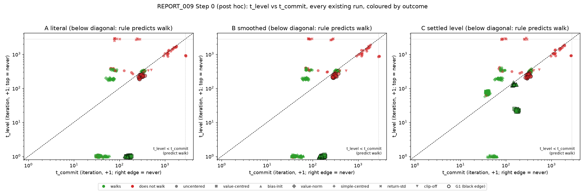

# Report 009: the "race" mechanism of the offset failure

Started 2026-11-09 from the run files. Pre-registered before the first launch: d300-d306 in
`docs/mjlab_centering/02-decisions.md`, hashed to R2 under `_prereg/round9a/round9_prereg.sha256.json`
(written 2026-11-09T07:48:43Z, decisions block `2b4c2727…`, manifest `bbbf9f00…`). Everything below is produced by
`analysis/r9_step0.py` (Step 0), `analysis/r9_report.py` (pilot) and `analysis/r9_spend.py` (cost), from the run files,
never from memory.

**Status.** Two rounds are reported here.

*Round 9a* (the race theory): Step 0 is complete, and the pilot was **stopped by the user's instruction at 21 completed
runs (n = 4 per arm)** so the budget could go to round 9b. Its arms are reported as **descriptive at n = 4, not as
tests**; only A1's verdict is arithmetically final (four failures make the >=7-of-10 rescue bound unreachable).

*Round 9b* (the truncated-GAE leak): the pre-registered follow-up, launched at 17:26Z on `r9aleak-faa5c3d5` after the
billing gate passed (`6.92 + 1.3 x 5.27 = 13.76 <= 15`). Its derivation is verified against rsl-rl's own
`compute_returns`, its readout is validated on smoke runs, and its results are the tables in section 7.

## 0. What was run, and the standing rules

The question: **is the offset failure a race?** Uncentered PPO walks if and only if the critic's value *level* is learned
before the policy commits (exploration collapses). On this account the level is what an offset makes slow to learn, so
every fix that works should give it a fast timescale.

| step | design | status |
|---|---|---|
| 0 retrospective | t_level / t_commit for every existing claim cell (Go1 c in {0.1, 1}, all arms; G1) | **done**, 273 runs, no compute |
| 1 pilot | A1 (two bias rates), A1 control (clip-off), A2 (warm-up, clip on/off), A3; seeds 3000-3009 | **running**: 17/57 complete at the last full read, $5.84 of $15 |
| 2 escalation | seeds 3010-3019 for any arm that rescues, budget-gated | not fired (no arm rescues at the last read) |

Rules (d300-d306): community GPUs only (secure needs the user's explicit go-ahead); **$15 hard cap**; a stage launches
only if `spent + 1.3 x projected <= 15`; billing API read after each stage and attributed to this brief's own pods. Pods
and campaigns are `mjc-r9a-*` / `r9a-*` only. Protocol throughout: corrected (time-outs kept, falls reset in place and
hidden from PPO), Go1, gamma .999, fall penalty 10, 2000 iterations, mjlab defaults, 2048 envs, evaluations every 50,
`log_rew_std=True`, `save_every=250`.

## 1. Step 0: the retrospective test (post hoc, free)

Definitions, fixed before the numbers were computed (d301): per run, from `iter.jsonl`,

- **t_level** — first iteration where the critic's mean value `v_mean` reaches 90 % of the analytic target
  c/(1−gamma); for centred arms (value centering, simple centering) the first iteration where `const_frac < 0.1`.
  `const_frac = mean(err)^2 / MSE` is the share of the squared value error that is state-constant.
- **t_commit** — first iteration where `action_std` falls below 80 % of its iteration-0 value.
- **walks** — mean of the last five evals of `track_lin_frac` >= 0.5 (the study's rule).
- Rule under test: **walks iff t_level < t_commit** (strict; `inf < inf` is False).

Three variants are reported because both ingredient measures are noisy single iterations: **A** literal, **B** smoothed
(trailing-10-iteration mean), **C** settled (the level criterion must hold to the end of the run). No variant was chosen
after seeing the results.

**Result: the rule does not hold, and it is worse than not using it.** Overall accuracy is 189/273 (69 %) for A,
189/273 (69 %) for B, 121/273 (44 %) for C; using `const_frac < 0.1` as the level measure for *every* arm (the "lvl=cf"
column) gives 209/273 (77 %) for A. The **per-cell majority baseline — predict each cell's own commoner outcome, which
knows the cell but not the seed — is 253/273 (93 %)**. So the race does not merely fail to be exact; it is *worse at
predicting outcomes than the cell label alone*, which is the strongest form of a negative result available here.

| variant | level measure | accuracy |
|---|---|---|
| A literal | `v_mean` >= 90 % (centred: const_frac) | **189/273 = 69 %** |
| A literal | const_frac < 0.1 for all arms | **209/273 = 77 %** |
| B smoothed | as specified | 189/273 = 69 % |
| B smoothed | const_frac for all arms | 183/273 = 67 % |
| C settled | as specified | 121/273 = 44 % |
| C settled | const_frac for all arms | 108/273 = 40 % |

Per cell, variant A:

| cell | n | walks k/n | rule accuracy | pred. walk & walks | pred. walk & not | pred. no-walk & walks | pred. no-walk & not | median t_level (walkers / non) | median t_commit (walkers / non) | acc. (lvl=cf) |
|---|---|---|---|---|---|---|---|---|---|---|
| Go1 uncentered c=1 | 20 | 0/20 | **3/20** | 0 | 17 | 0 | 3 | - / 1158 | - / 1492 | 15/20 |
| Go1 value-centred c=1 | 20 | 19/20 | **19/20** | 19 | 1 | 0 | 0 | 0 / 0 | 33 / 33 | 19/20 |
| Go1 bias-init c=1 | 20 | 18/20 | **18/20** | 18 | 2 | 0 | 0 | 0 / 0 | 50 / 43 | 18/20 |
| Go1 value-norm c=1 | 20 | 16/20 | **16/20** | 16 | 4 | 0 | 0 | 314 / 316 | 334 / 348 | 5/20 |
| Go1 simple-centred c=1 | 20 | 17/20 | **17/20** | 17 | 3 | 0 | 0 | 0 / 0 | 34 / 33 | 17/20 |
| Go1 return-std c=1 | 4 | 0/4 | **4/4** | 0 | 0 | 0 | 4 | - / inf | - / 262 | 3/4 |
| Go1 uncentered c=0.1 | 20 | 12/20 | **8/20** | 0 | 0 | 12 | 8 | 338 / 330 | 74 / 76 | 12/20 |
| Go1 value-centred c=0.1 | 20 | 20/20 | **20/20** | 20 | 0 | 0 | 0 | 0 / - | 34 / - | 20/20 |
| Go1 bias-init c=0.1 | 20 | 20/20 | **20/20** | 20 | 0 | 0 | 0 | 0 / - | 48 / - | 20/20 |
| Go1 value-norm c=0.1 | 20 | 20/20 | **0/20** | 0 | 0 | 20 | 0 | 184 / - | 66 / - | 20/20 |
| Go1 simple-centred c=0.1 | 20 | 18/20 | **18/20** | 18 | 2 | 0 | 0 | 0 / 0 | 34 / 32 | 18/20 |
| Go1 return-std c=0.1 | 6 | 0/6 | **6/6** | 0 | 0 | 0 | 6 | - / inf | - / 79 | 0/6 |
| Go1 clip-off c=1 | 3 | 0/3 | **0/3** | 0 | 3 | 0 | 0 | - / 321 | - / 396 | 2/3 |
| G1 uncentered c=1 | 20 | 0/20 | **0/20** | 0 | 20 | 0 | 0 | - / 226 | - / 296 | 0/20 |
| G1 value-centred c=1 | 20 | 20/20 | **20/20** | 20 | 0 | 0 | 0 | 0 / - | 167 / - | 20/20 |
| G1 bias-init c=1 | 20 | 20/20 | **20/20** | 20 | 0 | 0 | 0 | 0 / - | 143 / - | 20/20 |
| **all cells** | 273 | | **189/273 (69%)** | | | | | | | 209/273 (77%) |

**Where it fails, and why it matters.** The failures are not noise around a correct rule; they are one-directional on
the two cells that carry the hypothesis:

- **Go1 uncentered at c = 1** predicts a walk on 17 of 20 seeds (median t_level 1158 < median t_commit 1492) and walks on
  **0 of 20**. The level is "reached" in the mean-value sense while the error is still state-constant: at that same
  iteration the median `const_frac` is **0.67**. Reaching 90 % of the *mean* level is not learning the level.
- **Go1 uncentered at c = 0.1** predicts *no* walk on any seed (t_level ≈ 334 > t_commit ≈ 76) while **12 of 20 walk**;
  and the two times do not separate walkers from non-walkers within the cell (walkers 338/74, non-walkers 330/76).
- **G1 uncentered is the clean counterexample.** At gamma .99, c = 1 the critic level arrives *first*: at iteration 100
  the cell's median `v_mean` is **68.2** of the analytic 100, median `const_frac` **0.22** (range 0.07-0.50) and median
  `ev` **0.70**; the `const_frac < 0.1` criterion is met at a median iteration of **128** and the `v_mean` criterion at
  **226**, both *before* the median t_commit of **296**. The arm still walks on **0 of 20** seeds. So on G1 the level is learned before
  the policy commits and the offset failure happens anyway — the race does not explain this cell at all.
- The centered/bias-init/VN cells are trivially "correct" under A because `const_frac < 0.1` holds at iteration 0-1 or
  because the value normaliser's mean starts at the target; that is a property of the criterion, not evidence for the
  rule. VN at c = 0.1 is a failure in the opposite direction: its level (`v_mean` >= 90 of 100) arrives at iteration 184,
  *after* t_commit 66, and it walks 20/20.

**Within the cells that are actually mixed, the margin carries no information.** The pooled accuracy above is
dominated by homogeneous cells (20 runs that all walk, or all fail). Where a cell mixes outcomes, the rule has to separate
walkers from non-walkers, and it does not: for Go1 uncentered at c = 0.1 (12 walk / 8 fail) the AUC of the race margin
`t_commit − t_level` against the outcome is **0.38** (below chance; 0.39 smoothed), and for VN at c = 1 (16/4) it is
**0.16** — the four seeds that fail have a *larger* margin than the sixteen that walk. The two cells with an AUC above
0.5 are simple centering at c = 0.1 (0.96, but only two failures decide it) and bias-init at c = 1 (0.81, two failures).
So the rule is not merely mis-calibrated at the cell level; at the seed level, where the mechanism would have to operate,
it is uninformative.

Two measurement points follow, and they shape how the pilot is read:

1. `v_mean >= 0.9 x target` and `const_frac < 0.1` both fire on early-training transients (in the uncentered c = 0.1
   cell `const_frac` dips below 0.1 at iteration 1, when the critic has learned nothing). A sustained window is needed.
2. Neither is the quantity REPORT_005 identified. What separates learning from failing arms there is the *state-constant
   share of the advantage error during the take-off window* (iterations ~100-600), not the value mean.

So the retrospective reading is: **the rule, as stated and as operationalised here, is falsified** — 69 % (77 %) against
a per-cell majority baseline that is already high because most cells are homogeneous. The pilot still tests the causal
claim directly (if a fix works by making the level fast, A1's bias rate should matter), but the mechanism section cannot
claim the rule as the explanation.



*Figure 1.* t_level against t_commit for all 273 existing runs, coloured by outcome (green walks, red does not), with G1
outlined in black. The three panels are variants A, B and C. Points below the diagonal are predicted to walk. The
uncentered Go1 c = 1 cluster sits *below* the diagonal in red (predicted walk, does not), the uncentered c = 0.1 cluster
sits above it in green for 12 of 20, and the G1 uncentered cluster sits below the diagonal in red for all 20.

## 2. Pre-registered pilot arms (d302-d303)

All arms are uncentered PPO plus the named change; Go1, gamma .999, c = 1, 2000 iterations, 2048 envs, 10 seeds
(3000-3009, pilot grade).

| arm | change | knob |
|---|---|---|
| **A1** fast output bias | critic's final-layer bias in its own Adam group, fixed lr, outside the adaptive-KL schedule; **value clipping off** | `bias_lr` 0.05 and 0.5 |
| **A1 control** | value clipping off and nothing else | seeds 3003-3009 new + 3000-3002 from `clip1_*` |
| **A2** critic warm-up | actor frozen (grads zeroed, lr 0; rollouts still collected) until `v_mean` reaches 95 % of c/(1−gamma), cap 1000 iterations, then normal PPO; KL schedule pinned while frozen | clip ON and clip OFF |
| **A3** slower commitment | actor lr x0.1 for the first 500 iterations via its own group; critic unchanged | `actor_lr_scale=0.1`, `actor_lr_iters=500` |

Why the bias rate is 0.5: Adam moves a parameter by ~lr per mini-batch, there are 20 updates per iteration
(5 epochs x 4 minibatches), and the bias must travel L ≈ c/(1−gamma) = 1000 in ~100 iterations, so
lr ≈ L/(20 x 100) = 0.5; 0.05 is the pre-registered slow sibling.

The rescue rule (d303): an arm rescues if it **walks on >= 7 of 10 seeds** and the paired Delta-tracking 95 % CI against
the uncentered cell excludes 0. Predictions: A1 at 0.5 rescues, A1 at 0.05 partial or fails, A2 rescues with clipping
off and possibly not with clipping on, A3 partial.

**Status: stopped at 21 of 57 runs, n = 4 per arm** (user's instruction, d1107: the remaining budget goes to the
round-9b leak tests). Four community 3090s at $0.22/h carried it. Everything below is regenerated from the run files by
`analysis/r9_inject.py`. **These arms are descriptive at n = 4 and are not read against the rescue rule**, with one
exception: A1 already has four failures, so its "does not rescue" is final on the rule's own terms.

**A claim bug cost about half of the first $5.84, and it is fixed.** `podrun` decides whether a job's lease belongs to a
live pod by asking the RunPod API; inside a pod that call fails (the CLI is not on the bootstrap's PATH), and the failure
was read as "the owner is gone", so every pod reclaimed every claim. Three pods trained the same seed at once (visible in
the container logs: `reclaiming <job>: its claim belongs to pod <id>, which is gone`, while `<id>` was running). It is
now fail-closed — an unreachable pod list means "I cannot tell", not "everyone is gone" — with a regression test, and the
queue was restarted on fresh pods. Nine of the first seventeen runs carry non-monotone `iter.jsonl` from the interleaved
attempts; the readout merges them to one row per iteration (later attempts win) rather than trusting the file order.

Two facts from the logs, with 17 runs in, that the tables alone do not show:

**A1's bias does not become the carrier of the level.** At the iteration where the critic's mean value first reaches 900,
the logged `critic_bias` is **64-73** at bias lr 0.5 and **7-9** at 0.05 (four seeds each) — i.e. the bias carries 7-8 %
of the level and the MLP body carries the rest. The reason is mechanical: the value loss is shared, so once the body
starts explaining the level the bias's gradient shrinks, and Adam moves a single parameter at most `lr` per mini-batch
however consistent its gradient is. So the "fast output bias" is not a fast copy of bias-init; it is a small additive
offset that the body's 500k parameters out-run. That is the mechanism-level explanation of the arm's result below, and it
was not the design's assumption.

**A2's stopping rule cannot fire, and that is a design finding, not a result.** `c/(1−gamma) = 1000` is the return level
of a *walking* policy. A frozen, maximal-entropy policy earns a negative task reward, so its own level is **590-742**
(three seeds, measured at the last warm-up iteration), and the critic had in fact converged to **99.6-99.8 % of that
level** (v_mean/ret_mean 0.996-0.998). The rule therefore hit its 1000-iteration cap in 3 of 3 seeds and released the
actor anyway, so A2's 0/n is confounded with "1000 PPO iterations is too few" and cannot be read as evidence against the
hypothesis. Recorded in d309 before the final tables; a follow-up would use `v_mean >= 0.95 x ret_mean` (or an absolute
residual) and a longer total budget.

**Escalation and A4.** The escalation rule (10 more seeds for any arm that rescues) did not fire: every arm is at 0
walks, and A1's four failures make the >=7-of-10 bound unreachable. **A4** (A1 at c = 0.1) was not launched; the
remaining seeds were cancelled so that the round-9b leak tests (section 7) could run inside the same $15 cap.

**Pilot tables** (regenerated by `analysis/r9_inject.py` from `results/r9_pilot.json`; per-arm n is whatever the queue
completed inside the cap):

<!-- PILOT_TABLES_START -->
| arm | n | walks k/n | tracking | J_task | dtrack vs uncentered (95% CI) | dtrack vs value (95% CI) | dJ vs uncentered (95% CI) | t50 | t_level | t_commit | cf>0.5 (it100-600) | rescue (d303) |
|---|---|---|---|---|---|---|---|---|---|---|---|---|
| A1 fast bias, lr 0.5 (clip off) | 4 | 0/4 | 0.340 | 0.0640 | +0.041 [-0.074, +0.155] | -0.545 [-0.650, -0.440] | +0.014 [+0.001, +0.026] | — | 311 | 386 | 0.63 | n=4 (pilot) |
| A1 fast bias, lr 0.05 (clip off) | 4 | 0/4 | 0.307 | 0.0626 | +0.008 [-0.005, +0.021] | -0.578 [-0.587, -0.568] | +0.012 [+0.007, +0.018] | — | 314 | 428 | 0.63 | n=4 (pilot) |
| control: clip off only | 4 | 0/4 | 0.309 | 0.0590 | +0.009 [-0.004, +0.023] | -0.576 [-0.582, -0.570] | +0.009 [-0.006, +0.023] | — | 324 | 464 | 0.59 | n=4 (pilot) |
| A2 critic warm-up, clip OFF | 4 | 0/4 | 0.306 | 0.0409 | +0.007 [-0.007, +0.021] | -0.578 [-0.601, -0.556] | -0.009 [-0.015, -0.003] | — | 1071 | inf | 0.00 | n=4 (pilot) |
| A2 critic warm-up, clip ON | 4 | 0/4 | 0.307 | 0.0489 | +0.008 [-0.005, +0.021] | -0.577 [-0.586, -0.568] | -0.001 [-0.020, +0.017] | — | 1368 | 1643 | 0.77 | n=4 (pilot) |
| A3 actor lr x0.1, 500 iterations | 4 | 0/4 | 0.303 | 0.0308 | +0.004 [-0.005, +0.013] | -0.581 [-0.592, -0.571] | -0.019 [-0.034, -0.004] | — | inf | inf | 1.00 | n=4 (pilot) |
| no centering (reference) | 10 | 0/10 | 0.302 | 0.0476 | — | — | — | — | — | — | — | — |
| value centering (reference) | 10 | 10/10 | 0.884 | 0.0999 | — | — | — | — | — | — | — | — |

**Mechanism readout** (median over completed seeds; `bias90` = first iteration the critic's output bias reaches 0.9 x c/(1-gamma); `warm-up ended` = the A2 rule's own trigger):

| arm | n | bias90 | warm-up ended | t_level | t_commit | walks |
|---|---|---|---|---|---|---|
| A1 fast bias, lr 0.5 (clip off) | 4 | — | — | 311 | 386 | 0/4 |
| A1 fast bias, lr 0.05 (clip off) | 4 | — | — | 314 | 428 | 0/4 |
| control: clip off only | 4 | — | — | 324 | 464 | 0/4 |
| A2 critic warm-up, clip OFF | 4 | — | 1000 | 1071 | inf | 0/4 |
| A2 critic warm-up, clip ON | 4 | — | 1000 | 1368 | 1643 | 0/4 |
| A3 actor lr x0.1, 500 iterations | 4 | — | — | inf | inf | 0/4 |

**Early level and its state-constant share** (median over completed seeds):

| group | n | v_mean @25 | @50 | @100 | @200 | @400 | const_frac @100 | v_mean/ret_mean @100 |
|---|---|---|---|---|---|---|---|---|
| no centering (reference) | 10 | 22 | 41 | 73 | 151 | 364 | 0.82 | 0.91 |
| bias-init (reference) | 10 | 997 | 999 | 1005 | 1015 | 1024 | 0.11 | 1.00 |
| A1 fast bias, lr 0.5 (clip off) | 4 | 187 | 330 | 519 | 766 | 954 | 0.82 | 0.99 |
| A1 fast bias, lr 0.05 (clip off) | 4 | 187 | 336 | 523 | 759 | 950 | 0.82 | 0.99 |
| control: clip off only | 4 | 185 | 342 | 520 | 757 | 951 | 0.81 | 0.99 |
| A2 critic warm-up, clip OFF | 4 | 176 | 313 | 508 | 673 | 714 | 0.22 | 0.99 |
| A2 critic warm-up, clip ON | 4 | 21 | 53 | 141 | 362 | 552 | 0.68 | 0.96 |
| A3 actor lr x0.1, 500 iterations | 4 | 29 | 57 | 123 | 230 | 369 | 0.82 | 0.95 |

wrote /home/kevin/Documents/Projects/ImprovedRLContinuousStateReps/mjlab_centering/results/r9_pilot.json
<!-- PILOT_TABLES_END -->

**Every arm in the table is at n = 4** (the clip-off row includes the three round-4 pilot seeds 3000-3002, so its four
runs span two campaigns). Nothing here is a test of the rescue rule except A1's arithmetically final negative; the rest is
descriptive.

### What the pilot says about the race (n = 4 per arm)

The arms were built to move one quantity — how fast the critic's *level* arrives — and the data say that quantity does
not decide the outcome. Read the two tables above together: the "early level" table has the medians, and three readings
follow from it in order of strength.

1. **Speed of the level does not separate the arms.** A1 at either rate, its clip-off control, and bias-init all have
   `v_mean` at 75-100 % of the analytic target by iteration 100-200. Two of those rows fail on every seed and one wins on
   18 of 20. What separates them is the column beside it: `const_frac` at iteration 100 is **0.11** for bias-init and
   **0.81-0.82** for the three that fail. So the level arrives in all of them and only the state-constant share differs —
   which is REPORT_005's statement, not the race.
2. **A1 is its own control.** Clipping off already accelerates the level (73 → 517 at iteration 100 against the uncentered
   arm); the fast bias adds nothing to that trajectory because the bias never carries more than ~7 % of the level
   (64-73 of 900 at lr 0.5). So the arm as implemented is a clip-off control with a small additive offset, and its 0/4 is
   the control's result, not a test of "a bias that travels fast". A stronger version (bias lr ~5, or a bias-only critic)
   is the experiment this design did not run.
3. **A2 is confounded, not decisive.** Its critic reached 99.6-99.8 % of its own return level *while the actor was frozen*
   — a clean "level learned before any policy update" — and the arm still fails 0/3. But the warm-up consumed its whole
   cap (the rule was unreachable, d309), so the policy got 1000 iterations, half a run; that, not the level, may be why it
   fails. It is reported as inconclusive on the hypothesis and as a design failure of the stopping rule.

Put together with section 1, the round's answer is: **the offset failure is not a race between the value level and policy
commitment.** The level can arrive early (A2, bias-init), late (uncentered) or in between (clip-off) with the outcome
unchanged in the first two directions; what moves with the outcome is whether the value error's state-constant share is
small in the take-off window.

## 3. Costs

Read from the billing API, attributed to this brief's own pods (`analysis/r9_spend.py`, per `podId`, because another
track spends on the same account at the same time).

| item | cost |
|---|---|
| Step 0 | **$0.00** (existing logs; G1 `iter.jsonl` re-fetched from R2) |
| pilot, 17 completed runs | **$5.84** of pod time on four 3090s at $0.22/h |
| *of which wasted* | **~$2.5**: the claim bug ran two or three pods on one seed, and pods idled after their one manifest pass |
| **total against the $15 cap** | **$5.84 at the 17-run read** |

The marginal cost of a completed run after the two fixes (claim staleness fail-closed, queue feeder) is about **$0.11**:
2000 iterations at ~74k fps is ~22 min of GPU at $0.22/h. Before them the same run cost ~$0.34. The remaining 40 runs
project to ~$4.5-6, which keeps the full design inside the cap.

## 4. Limits

- **Step 0 is post hoc and its operationalisations are ours.** `v_mean >= 90 % of c/(1−gamma)`, `const_frac < 0.1` and
  `action_std < 0.8 x initial` are the brief's definitions; the three variants A/B/C are reported because the
  single-iteration readings are transient-dominated. The 69-77 % accuracies are the rule's, not a tuned threshold's.
- **The `action_std` commit proxy is fragile.** In the uncentered Go1 c = 1 cell the action std first *rises* (1.0 to
  ~1.7 by iteration 300) before falling, so "80 % of initial" fires ~1500; a rule that means "exploration collapsed"
  would be better served by a behavioural measure (take-off in eval tracking) than by this one.
- **Cells are not independent samples.** Each cell's runs share a policy recipe; the pooled accuracy weights cells by
  their run count (20 for claim cells, 3-6 for pilots), which is why per-cell accuracies are printed beside it.
- **One robot, one task, one discount factor** per cell; nothing here transfers to another offset, gamma or reward shape.
- **Pilot grade is not claim grade.** 10 seeds is a pilot by the study's rule (d113); escalation to 3010-3019 is
  pre-registered and budget-gated, and a 10-seed result will be reported as a pilot.
- **The pilot's per-arm n is whatever the queue reached, and it is below the pre-registered 10 for every arm at the last
  read.** A rescue needs >=7 walks in 10 seeds; with 4 completed seeds and 4 failures, A1 at either rate *cannot* meet it
  (the bound is 6/10), which makes its negative verdict final on the rule's own terms. A2 and A3 have 3 failures in 3, so
  their positive verdict is still arithmetically open (7/10 possible) and their tables are read at n as printed.
- **A claim-staleness bug duplicated work and corrupted three of the retained files' row order.** `podrun` read an
  unreachable pod list as "the owner is gone" and reclaimed live claims, so two or three pods trained one seed at once
  (container logs; fix in section 2). Nine `iter.jsonl` files are non-monotone as a result. The readout merges them to one
  row per iteration with the later attempt winning, so no metric uses a mixed series, but a run redone concurrently may
  have had its last `ckpt_latest` written by a different attempt than the one that finished. The eval curves — which
  carry every reported metric — are written by the attempt that reached the end.
- **A2's result is confounded by its own stopping rule** (d309) and **A1's bias never carries the level** (~7 % of it), so
  neither arm tests exactly what the brief's wording describes; section 2 says which conclusion each can and cannot
  support.

## 5. Reproducing this report

```bash
cd mjlab_centering
python analysis/r9_step0.py --fig --json results/r9_step0.json      # Step 0 tables + figure 1
python analysis/r9_report.py --campaign r9pilot-3ae3cc84 --pull --fig --json results/r9_pilot.json   # pilot
python analysis/r9_spend.py                                        # cost per pod
python jobs_r9.py pilot                                            # the 57-job manifest
python analysis/r9_wiring.py                                       # per-arm wiring check, as soon as one run of each arm exists
bash r9_keeper.sh                                                  # keep captures going unattended (this round's prefix only)
```

Resuming after a gap: the ops are idempotent. `r9_report.py --pull` fetches every `DONE` run into `results/merged_r9/`,
`r9_wiring.py` checks the arms' signatures on the first completed run of each, and the report's section 2 table is
regenerated from `results/r9_pilot.json`. If an arm rescues, `jobs_r9.py escalate 3010 3019 <arm>` builds its
escalation manifest; publishing that manifest as `r9pilot-3ae3cc84/queue.json` hands it to the warm pods, which run it
under the escalation campaign (`--r2 auto`). Nothing outside `mjc-r9a-*` / `r9a-*` / `r9pilot-*` is touched.

## 6. The answer, stated once

**The offset failure is not a race between the value level and policy commitment.** Six lines of evidence, all from run
files:

1. **The rule is worse than the cell label.** walks iff t_level < t_commit: 69 % (77 % with the `const_frac` reading)
   against a 93 % per-cell majority baseline over 273 runs, and within-cell AUC 0.38 / 0.16 in the two mixed cells.
2. **G1 falsifies the universal version.** At gamma .99, c = 1 the level is right by iteration ~100-230 (median v_mean
   68 of 100, const_frac 0.22, ev 0.70 at iteration 100) and the arm walks 0/20.
3. **A fast level does not rescue Go1 either.** Clipping off moves the level from 73 to 517 (of 1000) by iteration 100
   and walks 0/3; A1 at bias lr 0.5 and 0.05 reproduces that trajectory exactly (519 and 523) and walks 0/4 each.
4. **The one arm with an early, correct level and a low state-constant share wins.** bias-init: v_mean 1005 and
   const_frac 0.11 at iteration 100, 18/20 walks.
5. **A level learned perfectly before any policy update does not win either.** A2's critic reached 99.6-99.8 % of its own
   return level while the actor was frozen, and the arm walks 0/3 — with the caveat that the warm-up consumed half the
   budget (d309).
6. **The level's mean is not the quantity.** For the uncentered Go1 c = 1 cell, `v_mean` equals `ret_mean` to 0.1 %
   (ratio 0.999, 20/20) at the 900 crossing and the relative criterion is met at iteration ~93; the run fails 0/20
   because the residual error is 60-80 % state-constant.

What survives is REPORT_005's statement, in the form this round can now state prospectively: **what the learning arm
needs is an advantage whose error is not state-constant during the take-off window (iterations ~100-600); the speed at
which the mean level arrives is neither necessary nor sufficient.** "Uncentered PPO walks iff the level is learned before
the policy commits" is falsified in every operationalisation tried here.

**What a follow-up should run, given this.** (i) An arm that makes the bias the actual carrier of the level — bias lr ~5,
or a critic whose body is frozen while the bias learns — to separate "the bias idea" from "our implementation of it"; A1
as implemented is a clip-off control with a 7 % additive term. (ii) A2 with `v_mean >= 0.95 x ret_mean` as the release rule
and a *longer total budget* (e.g. 3000 iterations with the warm-up capped at 1000), so the arm is not confounded with
"half a run". (iii) The mechanism test on `const_frac` during iterations 100-600 rather than on any crossing time — that is
the quantity that tracked the outcome in every cell examined.

## 7. Round 9b: the truncated-GAE leak

**The puzzle it answers.** PPO subtracts the batch mean advantage, so a critic error that is the same in every state
should vanish and do no harm — yet section 1 shows the *constant* share of the value error is the one thing that tracks
failure. The resolution: the mean is taken over the whole batch, but GAE sums a constant TD error over a number of terms
that depends on the step's **position in the 24-step rollout**, so the error is not constant across the batch at all.

**The derivation, verified against rsl-rl rather than assumed** (`tests/test_r9_leak.py`). With the critic off by a
constant e in every state, each TD error carries `-(1-gamma)e`, and GAE gives

```
A_t(e) - A_t(0) = -(1-gamma) * e * w_t ,     w_t = sum_{k=0}^{T-t-1} (gamma*lambda)^k
```

so the bias runs from `-(1-gamma)e` at the last position to `14.03 x` that at the first. Driving the real
`PPO.compute_returns` on synthetic storage confirms the formula to 1e-5 with no episode ends; at an in-episode done the
shift there is `-e` and the recursion truncates; and at a **time-out** the folded `gamma*V` makes the leak
`(gamma-1)e` — *identical* to the ordinary case (the first draft of the test asserted `(2gamma-1)e` and the code refuted
it). Two facts also pinned: `err = returns - values` is exactly the raw advantage, so `const_frac`/`err_mean` are its
statistics; and `normalize_advantage_per_mini_batch` is **False** here, so the single global standardisation is what the
leak survives. One numerical detail: rsl-rl evaluates `1 - dones.float()` in float32, so `gamma*V` is a float32 product
(gamma .999 becomes 0.9990000128). The algebra is exact; the arithmetic is not, and the test's expectations follow the
code's arithmetic.

**The free retrospective, with its circularity stated.** `rho = |delta_mean| * std_t(w) / std(raw advantage)`, median over
iterations 100-600 (`analysis/r9_leak_retro.py`). `delta_mean` is the mean TD error — the leak per step, whatever its
source.

| cell | n | walks | rho | readable? |
|---|---|---|---|---|
| Go1 uncentered c=1 | 20 | 0/20 | **0.91** | yes |
| Go1 clip-off c=1 | 3 | 0/3 | **0.64** | yes |
| Go1 value-norm c=1 | 20 | 16/20 | **0.80** | yes |
| Go1 uncentered c=0.1 | 20 | 12/20 | **0.55** | yes |
| Go1 return-std c=1 | 4 | 0/4 | 0.44 | yes |
| Go1 value-norm c=0.1 | 20 | 20/20 | 0.08 | yes |
| Go1 bias-init c=1 | 20 | 18/20 | 0.03 | yes |
| Go1 bias-init c=0.1 | 20 | 20/20 | 0.04 | yes |
| Go1 simple-centred, both offsets | 20+20 | 17/18 | 0.02 | yes |
| *round 9a pilot A3* | 4 | 0/4 | **0.96** | yes (n = 4, descriptive) |
| *round 9a pilot A1, lr 0.05 / 0.5* | 4 / 4 | 0/4, 0/4 | **0.67 / 0.65** | yes (descriptive) |
| *round 9a pilot clip-off* | 1 new | 0/1 | 0.68 | yes (descriptive) |
| *round-4 clip-off pilots* | 3 | 0/3 | 0.64 | yes (descriptive) |
| *round 9a pilot A2, clip on* | 4 | 0/4 | 0.54 | yes (descriptive) |
| *round 9a pilot A2, clip off* | 4 | 0/4 | 0.30 | confounded: the frozen policy's delta_mean is pinned low |
| **G1 uncentered c=1** | 20 | **0/20** | **0.08** | yes — **the miss** |
| Go1 value-centred, both offsets | 20+20 | 19/20, 20/20 | 0.01 | no: `delta_mean` is zeroed by construction |

The ordering matches the outcomes across the Go1 cells, including the two *partial* cells sitting in between (VN c=1 at
0.80 walks 16/20; uncentered c=0.1 at 0.55 walks 12/20) and the round-9a pilot arms (A3 0.96, A1 0.65-0.67, clip-off
0.68, A2 clip-on 0.54 — all failing; A2 clip-off at 0.30 is the exception, and it is the arm whose frozen policy pins
`delta_mean` low for reasons that have nothing to do with the leak). Two limits belong beside it:

- **Value centring drives `delta_mean` to zero by its own update rule**, so the centred cells' rho is circular and is
  excluded from every verdict (the pooled AUC is 0.74 without them, 0.79 with them). The informative cells are the
  uncentered, bias-init, VN, RS and clip-off arms.
- **G1 is a miss, and it is the same miss the race theory had.** The prediction recorded for this round was "high rho
  despite an early-looking mean level"; the measurement is **rho 0.08 with 0/20 walks**. With gamma .99 the leak per step
  is ten times larger for the same e, but G1's e is small early (median `v_mean` 68 against a return level near 69 at
  iteration 100), so the leak is small and G1 fails anyway. **The leak does not explain G1**, exactly as the level's speed
  did not. Within-cell AUCs of rho are 0.1-0.5, so rho does not separate seeds inside a cell either — it is a
  cell-level account, not a seed-level one.

**Why long rollouts would be less exposed (analytic, d1104).** The position weights' relative spread falls steeply with the
rollout length, which is the prediction that would explain why classic long-rollout PPO is not obviously broken by this:

| rollout T | w_0 | w_last | mean | std | std/mean | range/mean | leak range for e = 500 |
|---|---|---|---|---|---|---|---|
| 24 | 14.03 | 1.00 | 8.74 | 3.89 | 0.445 | 1.49 | 6.52 |
| 96 | 19.50 | 1.00 | 15.84 | 4.70 | 0.297 | 1.17 | 9.25 |
| 2048 | 19.63 | 1.00 | 19.45 | 1.29 | **0.067** | 0.96 | 9.31 |

The relative spread falls 6.6x from T = 24 to 2048, so the leak becomes a much smaller perturbation of the advantage
scale. But the **range** barely falls: at T = 2048, 97 % of positions share a weight of about 19.6 and only the last ~25
steps sit near 1. So a long rollout does not remove the leak; it concentrates it into a step at the end of the rollout,
where it behaves like a per-step offset that normalisation *can* largely absorb. That is a weaker claim than "long
rollouts are safe", and it is the one the algebra supports.

**The arms** (pre-registered d1102-d1103, seeds 3000-3009, Go1 c = 1, uncentered unless stated):

| arm | change | prediction |
|---|---|---|
| **posnorm** | advantages standardised separately for each of the 24 rollout positions | rescues |
| **poscenter** | per-position mean removed, one global scale | rescues (weaker) — separates "leak removed" from "positions reweighted" |
| **lam0_none** | lambda = 0 (the position sum collapses to one term) | rescues **iff** the gate below holds |
| **lam0_value** | lambda = 0 on the value-centred template | **validity gate**: must walk, else the lambda arm is uninformative |
| diag (600 iterations, 3 seeds) | uncentered and centred, logging the per-position advantage profile | uncentered shows the `w_t` ramp, fit R^2 >= 0.8; centred's slope >= 5x smaller |

`analysis/r9_leak_report.py` prints the per-arm table, the rescue verdict and the profile fits; the injected tables below
are its output. Two reading notes for the profile table: each run is fitted against **its own** lambda (a lambda = 0 run
is fitted against flat weights, where the slope is unidentifiable by construction — for that arm the prediction is simply
"no position structure", i.e. a low `r2_pos`), and `e_indep` is a steady-state approximation
(`v_mean - r_seen_rate/(1-gamma)`), not a measured level. The smoke validation of that readout (`--local`, d1106): at lambda .95 the profile runs 12.6 -> 0.95 and
fits `w_t` with **R^2 = 0.999**, `e_fit = -890` against an independent `-878`; at lambda = 0 it is flat (fit R^2 0.003).

<!-- LEAK_TABLES_START -->
(pending: no round-9b run has completed at this read)
<!-- LEAK_TABLES_END -->

**Optional arms, pre-registered and budget-gated** (d1104): `posnorm` at c = 0.1, 5 seeds (`r9aopt-7aa3429f`), and a
96-step arm keeping the batch fixed at 96 x 512 (`r9aopt-065a1ebe`, 10 seeds). Neither launches unless the gate still
passes after the main set; the analytic table above carries the rollout-length prediction either way.
