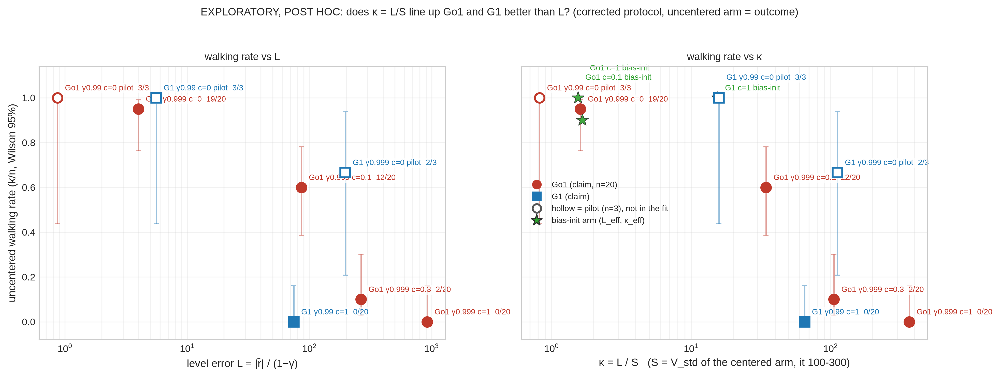
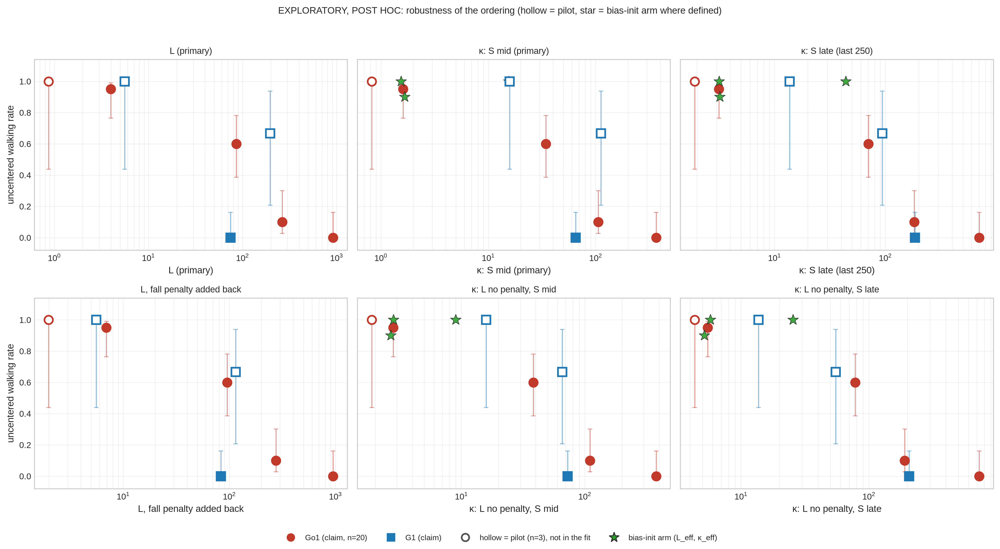
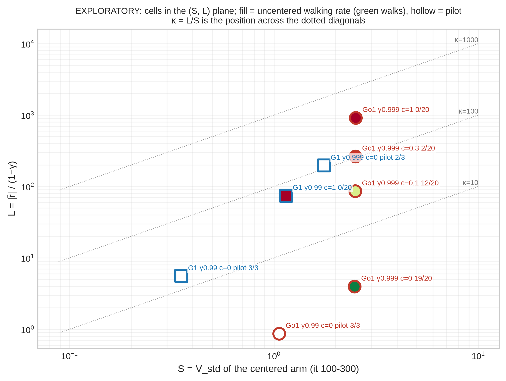

# Does κ = L / S line up the Go1 and G1 offset failures? (exploratory, post hoc)

**Status: exploratory, post hoc, hypothesis-generating.** None of this was pre-registered, nothing was run or paid for, and
no claim in the reports rests on it. Everything is computed from cached corrected-protocol runs by
`mjlab_centering/analysis/kappa_analysis.py` (outputs in this folder: `results.json`, `tables.md`, `fig*.png/.pdf`).
Legacy waves 1-9, the buggy v1 pilot, the g1diag cells, clip-off and the retired penalty-10 G1 cells are not used.

## 1. Hypothesis and quantities

Uncentered PPO fails when the critic's initial level error is large relative to the real value differences between states.

- **r̄**: mean per-step reward the learner sees, the logged `r_seen_rate` of the **uncentered** arm, averaged over iterations 0-100
  (per seed, then over seeds). It includes the offset and the fall penalty. Checked on all cells: `r_seen = r_task + offset − P·fall_rate/1000` exactly.
- **L = |r̄| / (1−γ)**. Absolute value because r̄ is slightly negative in the offset-0 cells (no offset to outweigh the task and fall terms).
- **S**: mean of the logged `v_std` of the **centered arm of the same cell**, iterations 100-300 ("mid", primary) and the last 250 iterations
  ("late", robustness). Seed-to-seed SD of S is small (table below), so S is a stable cell property.
- **κ = L / S.** Prediction: uncentered walking rate falls as κ rises, and κ orders Go1 and G1 consistently where L alone does not.
- "Walks" = mean of the last 5 evals of `track_lin_frac` ≥ 0.5 (REPORT_004 / supervisor-figure convention). Wilson 95% intervals.

Cells (all corrected protocol: time-outs kept, falls reset in place and hidden from PPO):

- **Claim-grade (n=20 per arm, used in the fits):** Go1 γ .999, c ∈ {0, 0.1, 0.3, 1} (jobs `w2off0`+`r4off0`, `r4sweep`, `w2main`; penalty 10, 2000 its);
  G1 γ .99, c = 1, the `r6g1queue-0ede5636` claim set (penalty 5.7, 2500 its). **All 60 G1 claim jobs are finished (n = 20 / 20 / 20 for uncentered / centered / bias-init).**
- **Pilots (n=3, hollow markers, not in any fit):** Go1 γ .99 c=0 (seeds 3000-3002, centered counterpart exists);
  G1 γ .999 c=0 (seeds 1000-1002, penalty 5.7, centered counterpart exists);
  G1 γ .99 c=0 (`fix_g1_raw_none_o0`, seeds 1000-1002, **penalty 0**, **no centered counterpart**, so S comes from the uncentered arm; marked †).
- **Reference (stars):** bias-init arms, Go1 c=0.1, Go1 c=1, G1 c=1.

Logged quantities: `r_seen_rate`, `r_task_rate`, `fall_rate_per_1k` and `v_std` are all in every cell's `iter.jsonl`, so no substitutions were needed.
Data access: Go1 and pilot cells from `results/merged_r2` / `merged_r4`; the G1 claim set from `results/supervisor_cache/g1` plus a read-only R2 top-up
(`--fetch`: 60 DONE markers, 71 small files, and ranged reads of `iter.jsonl`, about 31 MB in `results/kappa_cache/`). Windows are used only if complete.

## 2. Table

| cell | robot | γ | c | n (unc / cen) | r̄ (it 0-100) | L | S mid (± SD over seeds) | S late (± SD) | κ mid | κ late | walks k/n [Wilson 95%] | mean tracking (unc) |
|---|---|---|---|---|---|---|---|---|---|---|---|---|
| Go1 g.999 c=0 | go1 | 0.999 | 0 | 20 / 20 | -0.0040 | 3.98 | 2.48 ± 0.073 | 1.26 ± 0.23 | 1.61 | 3.15 | 19/20 [0.76, 0.99] | 0.854 |
| Go1 g.999 c=0.1 | go1 | 0.999 | 0.1 | 20 / 20 | +0.0860 | 86.0 | 2.5 ± 0.05 | 1.22 ± 0.02 | 34.5 | 70.4 | 12/20 [0.39, 0.78] | 0.645 |
| Go1 g.999 c=0.3 | go1 | 0.999 | 0.3 | 20 / 20 | +0.2645 | 264 | 2.5 ± 0.072 | 1.45 ± 0.56 | 106 | 183 | 2/20 [0.03, 0.30] | 0.362 |
| Go1 g.999 c=1 | go1 | 0.999 | 1 | 20 / 20 | +0.9182 | 918 | 2.51 ± 0.071 | 1.3 ± 0.36 | 366 | 704 | 0/20 [0.00, 0.16] | 0.307 |
| G1 g.99 c=1 | g1 | 0.99 | 1 | 20 / 20 | +0.7451 | 74.5 | 1.15 ± 0.037 | 0.403 ± 0.03 | 65.0 | 185 | 0/20 [0.00, 0.16] | 0.309 |
| Go1 g.99 c=0 (pilot) | go1 | 0.99 | 0 | 3 / 3 | +0.0087 | 0.869 | 1.06 ± 0.037 | 0.457 ± 0.01 | 0.821 | 1.9 | 3/3 [0.44, 1.00] | 0.888 |
| G1 g.999 c=0 (pilot) | g1 | 0.999 | 0 | 3 / 3 | -0.1967 | 197 | 1.76 ± 0.026 | 2.09 ± 0.013 | 112 | 94.1 | 2/3 [0.21, 0.94] | 0.527 |
| G1 g.99 c=0 (pilot) | g1 | 0.99 | 0 | 3 / 0 | -0.0558 | 5.58 | 0.352 ± 0.0037 † | 0.407 ± 0.0042 † | 15.8 | 13.7 | 3/3 [0.44, 1.00] | 0.732 |

† S taken from the uncentered arm (no centered counterpart exists).

Reading the table: **S is the same for every Go1 cell (2.5 mid, 1.2-1.45 late) because the centered critic does not see the offset, so within Go1 κ is just L rescaled
by one constant.** The only place κ can differ in ordering from L is across robots, and that rests on one number: G1's S is 2.2x smaller than Go1's
(1.15 vs 2.5, seed SDs 0.04 and 0.07). The G1 c=1 cell sits at L = 74.5, below Go1 c=0.1 (L = 86, 12/20 walk) yet walks 0/20. In κ it moves to 65, between Go1 c=0.1 (κ 34, 12/20) and Go1 c=0.3 (κ 106, 2/20).

Robustness inputs (fall penalty added back to r̄, i.e. L from r_task + offset):

| cell | r_task + c | L (no penalty) | fall rate /1k (it 0-100) | κ mid, L no-penalty | κ late, L no-penalty |
|---|---|---|---|---|---|
| Go1 g.999 c=0 | +0.0069 | 6.94 | 1.09 | 2.8 | 5.49 |
| Go1 g.999 c=0.1 | +0.0956 | 95.6 | 0.96 | 38.3 | 78.3 |
| Go1 g.999 c=0.3 | +0.2753 | 275 | 1.08 | 110 | 190 |
| Go1 g.999 c=1 | +0.9506 | 951 | 3.24 | 379 | 729 |
| G1 g.99 c=1 | +0.8324 | 83.2 | 15.32 | 72.6 | 207 |
| Go1 g.99 c=0 (pilot) | +0.0199 | 1.99 | 1.12 | 1.87 | 4.35 |
| G1 g.999 c=0 (pilot) | -0.1151 | 115 | 14.31 | 65.5 | 55.0 |
| G1 g.99 c=0 (pilot) | -0.0558 | 5.58 | 14.71 | 15.8 | 13.7 |

Bias-init reference arms (critic output bias starts at c/(1−γ); L_eff = |r̄ − c|/(1−γ) is what is left, and S is taken from the centered arm of the same cell):

| cell | n | critic starts at | r̄ (bias arm, it 0-100) | L_eff = abs(r̄ − c)/(1−γ) | κ_eff mid | κ_eff late | walks k/n | mean tracking |
|---|---|---|---|---|---|---|---|---|
| Go1 g.999 c=0.1 bias-init | 20 | c/(1−γ) = 100 | +0.0961 | 3.86 | 1.54 | 3.16 | 20/20 | 0.883 |
| Go1 g.999 c=1 bias-init | 20 | c/(1−γ) = 1000 | +0.9958 | 4.17 | 1.66 | 3.2 | 18/20 | 0.821 |
| G1 g.99 c=1 bias-init | 20 | c/(1−γ) = 100 | +0.8224 | 17.8 | 15.5 | 44.1 | 20/20 | 0.820 |

## 3. Figures

**Figure 1.** Uncentered walking rate against L (left) and κ (right), x on a log axis. Circles Go1, squares G1, hollow = pilot (n=3), stars = bias-init arms plotted at (L_eff, κ_eff).
Bars are Wilson 95% intervals. In the right panel the five claim cells fall in monotone order; in the left panel the G1 point (0/20 at L = 74) lies to the left of Go1 c=0.1 (12/20 at L = 86), so no single threshold on L serves both robots.

**Figure 2.** Same plot for L, and for κ with S from the late window and/or L computed without the fall penalty (no labels; see Figure 1).

**Figure 3.** The (S, L) plane. κ is the position across the dotted diagonals; fill is the uncentered walking rate. Go1 cells stack in a vertical column (S fixed), G1 is shifted left by the smaller S.

PDF versions of all three sit next to the PNGs.

## 4. Regression comparison (descriptive)

Per-seed walking (0/1) on log10 L, and separately on log10 κ, **claim cells only: 5 cells, 100 seeds, 33 walk**; pilots overlaid in the figures but excluded here.
Firth-penalised logistic regression (the ordinary MLE is near-separated; Firth keeps estimates finite). Log-lik and AIC are the ordinary log-likelihood at the Firth estimate.
The G1 indicator is a single cell (one x value), so "x + robot" lets G1 be fitted freely and asks how much the data want that freedom.

| x | model | slope on x (per decade) | SE | robot (G1) coef | log-lik | AIC | McFadden R² | seed-level AUC | one threshold serves all 5 cells? |
|---|---|---|---|---|---|---|---|---|---|
| log10 L | x alone | -2.65 | 0.56 | – | -36.5 | 77.0 | 0.42 | 0.83 | no |
| | x + robot | -3.05 | 0.75 | -3.78 (SE 1.52) | -26.6 | 59.2 | 0.58 | | |
| log10 kappa (S mid, it 100-300) | x alone | -3.37 | 0.83 | – | -31.0 | 66.0 | 0.51 | 0.93 | yes |
| | x + robot | -3.06 | 0.75 | -2.75 (SE 1.51) | -26.6 | 59.2 | 0.58 | | |
| log10 kappa (S late, last 250) | x alone | -3.70 | 0.96 | – | -29.4 | 62.8 | 0.54 | 0.95 | yes |
| | x + robot | -3.09 | 0.78 | -2.22 (SE 1.52) | -27.0 | 60.0 | 0.57 | | |
| log10 L, no fall penalty | x alone | -2.99 | 0.63 | – | -36.5 | 77.1 | 0.42 | 0.83 | no |
| | x + robot | -3.42 | 0.82 | -3.85 (SE 1.52) | -26.2 | 58.4 | 0.59 | | |
| log10 kappa, L no fall penalty, S mid | x alone | -3.89 | 0.95 | – | -30.3 | 64.6 | 0.52 | 0.93 | yes |
| | x + robot | -3.43 | 0.82 | -2.69 (SE 1.51) | -26.2 | 58.4 | 0.59 | | |
| log10 kappa, L no fall penalty, S late | x alone | -4.22 | 1.07 | – | -28.6 | 61.3 | 0.55 | 0.95 | yes |
| | x + robot | -3.48 | 0.86 | -2.10 (SE 1.52) | -26.6 | 59.2 | 0.58 | | |

Reading it:

- **Without the robot indicator, κ fits clearly better than L:** log-lik −31.0 vs −36.5 (AIC 66.0 vs 77.0), seed-level AUC 0.93 vs 0.83, and one threshold on κ orders all 5 cells (it does not on L).
- **How much the indicator is still needed:** adding it improves AIC by **17.8 for L**, by **6.8 for κ (mid)** and by only **2.8 for κ (late)**; likelihood-ratio 19.8, 8.8, 4.8 (1 df, descriptive, not a test I would lean on at 5 cells).
  With the indicator, all variants reach about the same fit (log-lik −26.6 to −27.0), so the gain from κ is exactly "it absorbs part of the robot offset".
- **It does not absorb all of it.** The x-alone κ fit predicts a G1 walking rate of 0.19 (mid) / 0.12 (late) at G1's κ; L predicts 0.32. Observed 0/20; chance of 0/20 under those predictions is 0.016 (κ mid), 0.07 (κ late), under 0.001 (L).
  The robot coefficient on κ stays negative (−2.75, SE 1.51 mid; −2.22, SE 1.52 late), not excluded.
- Within-cell check (mixed-outcome cells, per-seed early L): no support. In Go1 c=0.1 the *failing* seeds have the *lower* early |r̄| (AUC 0.12 for "failure has higher L"); c=0.3 and c=0 are weak and sign-unstable across the two L definitions (AUC 0.53 / 0.39 and 0.63 / 0.21).
  Early r̄ also contains early task progress, so this is confounded and says nothing for or against κ across cells; it only means per-seed L is not a usable predictor.

| cell | walks | mean L, walking seeds | mean L, failing seeds | AUC (fail has higher L) | AUC, L without penalty |
|---|---|---|---|---|---|
| Go1 g.999 c=0 | 19/20 | 4.42 | 6.03 | 0.63 | 0.21 |
| Go1 g.999 c=0.1 | 12/20 | 91.8 | 77.4 | 0.12 | 0.09 |
| Go1 g.999 c=0.3 | 2/20 | 264 | 265 | 0.53 | 0.39 |
| G1 g.999 c=0 (pilot) | 2/3 | 197 | 196 | 0.50 | 0.50 |

## 5. Robustness: does the conclusion change?

No, in direction. Using S from the last 250 iterations, or L without the fall penalty, or both, the single-threshold result on κ and the AUC (0.93-0.95) are unchanged, and the single-threshold failure of L is unchanged.

- **Late S** (half of mid S or less in every claim cell; G1 drops to 0.40 from 1.15) moves G1 to κ = 185, level with Go1 c=0.3 (κ = 183, 2/20): this is the **best** alignment, with the smallest remaining robot term (ΔAIC 2.8).
- **L without the fall penalty** changes L by 4-12% in the offset cells (G1 83 vs 75, Go1 c=0.3 275 vs 264; the penalty is 0.09 of G1's 0.83 early reward but is dwarfed by the offset), and no ordering changes (ΔAIC for the indicator 18.7 for L, 6.2 / 2.1 for κ).
  I read "L from the task reward only (excluding the fall penalty)" as task + offset; the task reward alone (no offset) would make L ≈ 0 for every cell and would be meaningless for an offset hypothesis.
- Bias-init arms (reference): κ_eff = 1.5 and 1.7 for Go1 (20/20 and 18/20 walk) and 15.5 for G1 (20/20), all at the low-κ end where uncentered cells also walk. That is consistent with the hypothesis and nearly circular, since the bias removes the level by construction.
- Pilots, for what 3 seeds are worth: Go1 γ .99 c=0 (κ 0.8, 3/3) and G1 γ .99 c=0 (κ 15.8, 3/3) agree with the ordering. **G1 γ .999 c=0 (κ 112, 2/3 walk) does not fit well**: Go1 c=0.3 at κ 106 walks 2/20. The interval is wide ([0.21, 0.94]), but it points the wrong way, and its r̄ is negative (−0.20, mostly falls at 5.7 each), unlike the offset cells.

## 6. Verdict

**Unclear, leaning yes.** κ does line up the five claim cells in one monotone order where L alone does not (G1 fails at L = 74 while Go1 copes at L = 86), and it removes most, not all, of the robot difference in the logistic fit.
That is the direction the hypothesis predicts, and it survives the late-window and no-penalty variants. But the evidence is one robot ratio (S_Go1 / S_G1 ≈ 2.2) applied to one G1 cell, the κ-alone fit still over-predicts G1 walking (0.12-0.19 against 0/20), and the G1 γ .999 pilot points the other way.
I would carry this forward as a hypothesis to test with a prospective design (for example a G1 offset sweep), not as a finding.

## 7. Limits

- **Few cells.** Five claim cells and eight in total; the fits have two free parameters per model and the "robot" term is one cell. Everything here is descriptive.
- **Post hoc.** Windows (0-100, 100-300, last 250), the |r̄| convention, "L from task + offset" and the choice of regression were fixed by the brief after the data existed, and the data have been seen in earlier reports. Nothing was pre-registered.
- **Only two robots**, and robot is confounded with γ (Go1 .999, G1 .99), penalty (10 vs 5.7) and run length (2000 vs 2500 its) in every claim comparison. S may be reflecting the shorter horizon of γ = .99 (V is a shorter sum) rather than anything about the robot.
- **S is measured on the centered arm**, at one time: V_std is non-stationary (late S is about half of mid S) and depends on the policy's quality at that moment. The centered arm is a different training run from the uncentered arm whose outcome it is used to explain; and within Go1 it does not vary with c at all. The G1 γ .99 c=0 pilot takes S from the uncentered arm instead, which is not comparable.
- **κ is a ratio of two arms' logged quantities, not a measured critic error.** I use the offset-driven level of r̄ as the initial error, assuming V starts near 0 (true on average: logged `v_mean` ≈ 0.05 at iteration 0 in the example checked).
- **Early r̄ is not a pure offset:** it includes early task progress and fall penalties, and in the offset-0 cells it is negative.
- Per-seed outcomes are not independent of the cell: the regressions pool seeds within five cells, so the SEs understate cell-level uncertainty. Wilson intervals are per cell.
- The Firth estimate shrinks coefficients; the robot term in particular is biased toward 0 here.
