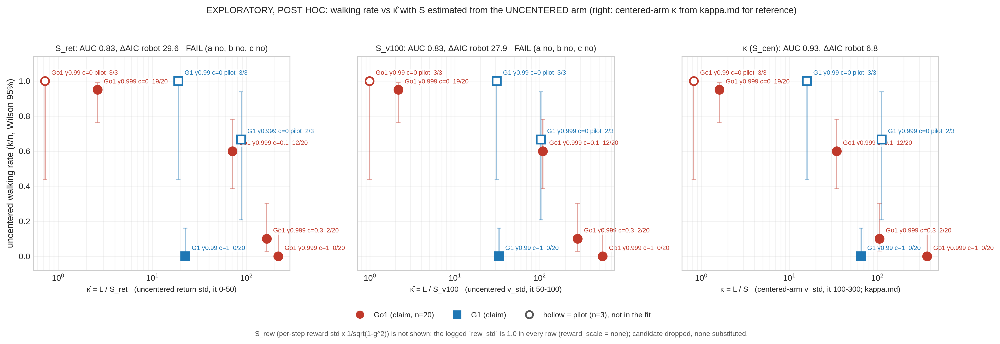

# Can κ be estimated without a centered run? (exploratory, post hoc)

**Status: exploratory, post hoc.** Cached logs only: no runs, no spend, read-only on R2 (nothing was fetched at all; every file was already in
`results/merged_r2`, `merged_r4`, `supervisor_cache`, `kappa_cache`). The SSP campaign and the video jobs were not touched.
Code: `mjlab_centering/analysis/kappa_early.py` (imports `kappa_analysis.py`: same cells, same seeds, same walking rule, same Firth fit,
same AUC, same single-threshold function). Outputs in this folder: `results.json`, `tables.md`, `fig_kappa_early.png/.pdf`.

**Verdict in one line: no candidate passes. Task 4 does not run.** S_rew is not available (not logged); S_ret and S_v100 each fail all three
conditions of the pre-registered rule, and neither beats L alone on ordering or AUC.

## 1. What was fixed before computing

Pre-registered in `docs/mjlab_centering/02-decisions.md` **d153** (sha256 of the file right after the entry:
`docs/analysis/kappa_early/prereg_d153.sha256.json`), before any κ̂ was computed. Three candidates, no others, all from the **uncentered** arm:

| candidate | definition |
|---|---|
| S_ret | std of the batch returns, per iteration, averaged over iterations 0-50 (per seed, then over seeds) |
| S_rew | std of the per-step **task** reward across envs (offset and fall penalty excluded), iterations 0-50, **× 1/√(1−γ²)** |
| S_v100 | uncentered `v_std`, averaged over iterations 50-100 |

**Formula for S_rew.** For independent per-step rewards with std σ, the discounted sum Σ γᵗ rₜ has variance σ² Σ γ²ᵗ = σ² / (1−γ²), so its std is
σ / √(1−γ²). (An approximation, since per-step rewards are autocorrelated; moot, see below.)

κ̂ = L / S with L exactly as in kappa.md (|r̄|/(1−γ), r̄ = uncentered `r_seen_rate` over iterations 0-100). κ̂ is a cell-level number.
Cells: the 5 claim cells (n = 20 per cell, 100 seeds) and the 3 pilot cells (n = 3, shown, not fitted).

**Pass rule (all three):** (a) κ̂ orders the 5 claim cells with one threshold (the `single_threshold_separable` test of kappa.md: at most one
flip of the ≥ 50 % indicator when cells are sorted by κ̂); (b) seed-level AUC ≥ 0.90 for log κ̂ alone; (c) adding the robot indicator improves AIC by < 10.

## 2. Field audit (what is and is not logged)

- **S_rew: not available, dropped, nothing substituted.** The logged `rew_std` is the running variance of the task reward, but `algo.py` updates it only when
  `reward_scale == "std"`. Every run here has `reward_scale = "none"`, and in all **21,715** early rows (iterations 0-100, every arm of every cell) `rew_std`
  is exactly 1.0, its initial value. Nothing else logs a per-step reward spread (`r_task_rate` is a mean; eval rows hold per-term means).
- **S_ret: `ret_std` is not a logged key (only `ret_mean`); I recovered it.** `algo.py` logs `ev = 1 − err_mse/(var_ret + 1e-8)`, so
  `var_ret = err_mse / (1 − ev)` is the exact variance of the same `ret` tensor (all 21,715 rows have `ev < 1` and positive variance). I read the brief's "or equivalent"
  as covering this, and flag it as **recovered, not logged**. If you read it as a substitution, S_ret drops out: the verdict does not change, because S_v100 (a directly logged key) fails
  on its own, and S_ret fails too.
- **S_v100: logged directly** (`v_std`).

I had read `algo.py` and checked `rew_std` before writing d153; no S value or κ̂ had been computed at that point, and d153 records the audit.

## 3. Cell table

| cell | n | L | S_cen (kappa.md) | κ (S_cen mid) | S_ret ± SD | κ̂ ret | S_v100 ± SD | κ̂ v100 | S_rew | walks k/n [Wilson 95%] | mean tracking (unc) |
|---|---|---|---|---|---|---|---|---|---|---|---|
| Go1 γ.999 c=0 | 20 | 3.98 | 2.48 | 1.61 | 1.52 ± 0.10 | 2.62 | 1.84 ± 0.061 | 2.16 | not logged | 19/20 [0.76, 0.99] | 0.854 |
| Go1 γ.999 c=0.1 | 20 | 86.0 | 2.5 | 34.5 | 1.22 ± 0.79 | 70.7 | 0.791 ± 1.3 | 109 | not logged | 12/20 [0.39, 0.78] | 0.645 |
| Go1 γ.999 c=0.3 | 20 | 264 | 2.5 | 106 | 1.61 ± 0.09 | 164 | 0.946 ± 0.19 | 280 | not logged | 2/20 [0.03, 0.30] | 0.362 |
| Go1 γ.999 c=1 | 20 | 918 | 2.51 | 366 | 4.23 ± 0.14 | 217 | 1.67 ± 0.44 | 550 | not logged | 0/20 [0.00, 0.16] | 0.307 |
| G1 γ.99 c=1 | 20 | 74.5 | 1.15 | 65.0 | 3.32 ± 0.067 | 22.4 | 2.25 ± 0.16 | 33.0 | not logged | 0/20 [0.00, 0.16] | 0.309 |
| Go1 γ.99 c=0 (pilot) | 3 | 0.869 | 1.06 | 0.821 | 1.20 ± 0.011 | 0.725 | 0.883 ± 0.012 | 0.985 | not logged | 3/3 [0.44, 1.00] | 0.888 |
| G1 γ.999 c=0 (pilot) | 3 | 197 | 1.76 | 112 | 2.25 ± 0.015 | 87.6 | 1.91 ± 0.012 | 103 | not logged | 2/3 [0.21, 0.94] | 0.527 |
| G1 γ.99 c=0 (pilot) | 3 | 5.58 | 0.352 † | 15.8 | 0.296 ± 0.00085 | 18.9 | 0.179 ± 0.006 | 31.1 | not logged | 3/3 [0.44, 1.00] | 0.732 |

† S_cen of this pilot is the uncentered arm's own `v_std` (no centered counterpart exists). ± is the SD over seeds.

**Ordering of the 5 claim cells by each x** (walking rate in brackets):

- L: Go1 c=0 (0.95) < **G1 c=1 (0.00)** < Go1 c=0.1 (0.60) < Go1 c=0.3 (0.10) < Go1 c=1 (0.00)
- κ̂ with S_ret: Go1 c=0 (0.95) < **G1 c=1 (0.00)** < Go1 c=0.1 (0.60) < Go1 c=0.3 (0.10) < Go1 c=1 (0.00)
- κ̂ with S_v100: Go1 c=0 (0.95) < **G1 c=1 (0.00)** < Go1 c=0.1 (0.60) < Go1 c=0.3 (0.10) < Go1 c=1 (0.00)
- centered-arm κ (kappa.md): Go1 c=0 (0.95) < Go1 c=0.1 (0.60) < **G1 c=1 (0.00)** < Go1 c=0.3 (0.10) < Go1 c=1 (0.00)

Both uncentered estimators put G1 below Go1 c=0.1, the same wrong place L puts it. In both cases the uncentered S is *larger* for G1 than for the Go1 cells that
are comparable in L, which is the opposite of the centered arm's S (G1 1.15 against Go1 2.5). The robot correction that made κ work came entirely from that centered-arm S.

## 4. Regressions (5 claim cells, 100 seeds, 33 walk; Firth, log-likelihood at the Firth estimate)

| x | model | slope per decade | SE | robot (G1) coef | log-lik | AIC | seed-level AUC | AIC gain from robot | one threshold, 5 cells? | strictly monotone rates? |
|---|---|---|---|---|---|---|---|---|---|---|
| L alone | x alone | −2.65 | 0.56 | – | −36.5 | 77.0 | 0.826 | | no | no |
| | x + robot | −3.05 | 0.75 | −3.78 (SE 1.52) | −26.6 | 59.2 | | **17.8** | | |
| centered κ (S mid), kappa.md | x alone | −3.37 | 0.83 | – | −31.0 | 66.0 | 0.934 | | yes | no |
| | x + robot | −3.06 | 0.75 | −2.75 (SE 1.51) | −26.6 | 59.2 | | **6.8** | | |
| **S_ret** | x alone | −2.00 | 0.40 | – | −45.3 | 94.7 | 0.826 | | **no** | no |
| | x + robot | −3.25 | 0.92 | −4.88 (SE 1.62) | −29.5 | 65.1 | | **29.6** | | |
| **S_v100** | x alone | −1.76 | 0.35 | – | −43.9 | 91.8 | 0.826 | | **no** | no |
| | x + robot | −2.73 | 0.76 | −4.72 (SE 1.60) | −28.9 | 63.9 | | **27.9** | | |

"Strictly monotone" is printed for information only and is not part of the rule; it fails even for the centered-arm κ (G1 at 0/20 sits below Go1 c=0.3 at 2/20, within noise).
Seed-level AUC is the same 0.826 as L for both candidates because the cell ordering is the same as L's, and AUC depends only on the ordering of the cells. Their log-likelihoods are
*worse* than L alone (−45.3 and −43.9 against −36.5, AIC 94.7 and 91.8 against 77.0) because the uncentered S increases with the offset, which flattens the slope.

## 5. Verdict per candidate

| candidate | (a) one threshold on the 5 cells | (b) AUC ≥ 0.90 (no robot) | (c) robot indicator gains < 10 AIC | verdict |
|---|---|---|---|---|
| S_ret (recovered, not logged) | no | no (0.826) | no (29.6) | **FAIL** |
| S_rew | n/a, not logged | n/a | n/a | **dropped** |
| S_v100 | no | no (0.826) | no (27.9) | **FAIL** |

Three candidates were tried (two were evaluable); none passed, so there is no multiple-comparison correction to argue about, but the count is three.
**Task 4 does not run** (gate in d153: no candidate passed; the centered-arm S is not used as a fallback). Nothing was launched or spent.

## 6. Figure

**Figure.** Uncentered walking rate against κ̂ for S_ret and S_v100, and the centered-arm κ of kappa.md for reference (same style as before; log x; Wilson 95 % bars; hollow = pilot, n = 3, not in the fit).
S_rew is absent because it is not logged. PDF next to the PNG.

## 7. Why it fails (diagnostic only; not a candidate, not used in any verdict)

The centered arm's S is flat in the offset (the centered critic never sees it). The uncentered arm's S in the early windows is not:

| cell | S_ret uncentered: median [min, max] over seeds | S_ret, same window, centered arm | S_v100 uncentered: median [min, max] | S_v100, same window, centered arm |
|---|---|---|---|---|
| Go1 γ.999 c=0 | 1.53 [1.36, 1.71] | 1.22 | 1.86 [1.69, 1.91] | 1.70 |
| Go1 γ.999 c=0.1 | 0.89 [0.83, 3.18] | 1.22 | 0.33 [0.08, 3.96] | 1.66 |
| Go1 γ.999 c=0.3 | 1.58 [1.49, 1.82] | 1.22 | 0.98 [0.58, 1.25] | 1.69 |
| Go1 γ.999 c=1 | 4.19 [4.07, 4.66] | 1.22 | 1.58 [0.84, 2.41] | 1.67 |
| G1 γ.99 c=1 | 3.32 [3.20, 3.42] | 1.98 | 2.29 [1.77, 2.43] | 1.94 |

- **S_ret grows with the offset** (Go1: 1.5 → 0.9 → 1.6 → 4.2 against a centered 1.22 at every c). That is consistent with the batch return std absorbing the offset: a rollout is 24 steps (49,152 steps per iteration / 2048 envs), returns are bootstrapped from a critic that starts at about 0,
  so a constant offset c makes the return depend on position in the rollout (about 24c at the first step, about c at the last). I did not test that mechanism; it is the reading the numbers suggest. So S_ret partly measures c, and dividing L by it removes the signal.
- **S_v100 is not monotone in c and is bimodal at c = 0.1** (0.08 to 3.96): the uncentered critic at iterations 50-100 is partway through learning the offset level, and what `v_std` measures there is the state of that transient, not a property of the value landscape. Walking and failing seeds at c = 0.1 have the same
  median S_v100 (0.33 and 0.33), so it does not separate outcomes within the cell either.
- In both uncentered windows, G1's S is *higher* than Go1's at comparable L, so the robot ratio that made κ work (S_G1 / S_Go1 = 0.46 in the centered arm) is absent or reversed.

The diagnostic does not form a κ̂ from the centered values (that would be a fourth estimator, which the pre-registration excludes).

## 8. Limits

- **Exploratory, post hoc**, even with the rule fixed in d153 first: the candidate list and windows come from the brief, the data had been seen in earlier reports, and κ itself was found post hoc. The rule was frozen before κ̂ was computed, which is what makes the "no" informative; it does not make κ a tested hypothesis.
- **Only three candidates were allowed.** A failure here is a failure of these three, not of "any early uncentered statistic". The diagnostic suggests the problem is structural (any S measured on the uncentered arm during the offset transient is contaminated by the offset), but I did not test other windows or other statistics, by instruction.
- **S_rew could not be tested at all** because no per-step reward spread is logged. A later run that logged it (cheap: two accumulators already exist in `process_env_step`, switched on only for `reward_scale = "std"`) could evaluate it; it is the only candidate that does not depend on the critic or the policy's value statistics at all, so its failure or success is not predicted by this report.
- **S_ret is recovered from `ev` and `err_mse`, not logged.** The identity is exact in the code, but I could not check it against a logged `ret_std`.
- **Five claim cells, one robot contrast.** The robot term is the G1 cell alone, confounded with γ (.99 vs .999), fall penalty (5.7 vs 10) and run length (2500 vs 2000); the fits' SEs treat the 100 seeds as independent within cells. All of this is as in kappa.md.
- **κ̂ is a cell-level number**; per-seed κ̂ (per-seed S) was not used (it would be a different candidate).
- The c = 0.1 cell is a mixture (12/20) and has extreme S_v100 seeds (range 0.08-3.96); the cell mean S_v100 (0.79) and median (0.33) differ by 2.4x. The fit uses the mean, as in the pre-registered definition.
- Pilot cells (n = 3) are plotted and tabulated, not fitted. G1 γ.999 c=0 (2/3) is a poor fit for every x here and in kappa.md.
- The working tree is not committed; the hash file records the decisions-log state after d153.
